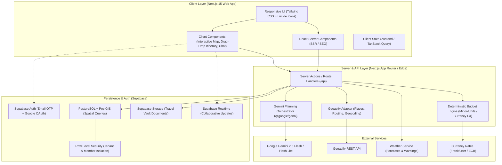
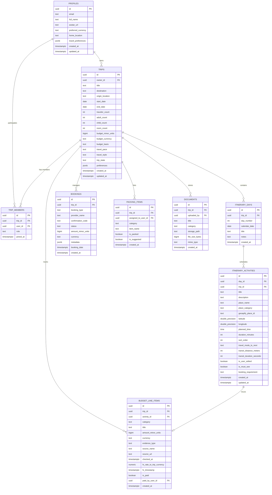
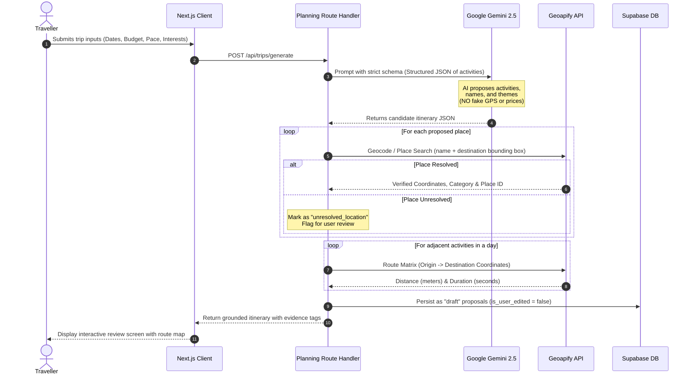

# WanderWay v3.0 — Comprehensive Architectural Implementation Plan

**Product:** WanderWay v3.0 (Web Application)  
**Core Stack:** Next.js 15 (App Router, React 19, TypeScript, Tailwind CSS), Supabase (PostgreSQL, PostGIS, RLS, Auth, Storage), Google Gemini API (`@google/genai`), Geoapify API.  
**PRD Reference:** PRD v3.0 Compliance (Traceable Evidence, Grounded AI, Deterministic Budgeting, User Control).

---

## 1. System Architecture Diagram



---

## 2. Supabase PostgreSQL Schema & ER Diagram

All monetary values are stored as **integer minor units** (e.g. `$15.50` = `1550` cents) with a 3-letter ISO `currency` code to eliminate floating-point drift.



---

## 3. Database Security & Row Level Security (RLS) Matrix

Default policy: **DENY ALL**. Access is granted explicitly via member relations.

| Table | SELECT | INSERT | UPDATE | DELETE |
| :--- | :--- | :--- | :--- | :--- |
| `profiles` | Authenticated users (public data) | Self (`auth.uid() = id`) | Self (`auth.uid() = id`) | Admin only |
| `trips` | Owner OR Trip Member | Authenticated user (`owner_id = auth.uid()`) | Owner OR Editor member | Owner only |
| `trip_members` | Trip Member OR Trip Owner | Trip Owner | Trip Owner | Trip Owner (or Self to leave) |
| `itinerary_days` | Trip Member OR Trip Owner | Owner OR Editor member | Owner OR Editor member | Owner OR Editor member |
| `itinerary_activities`| Trip Member OR Trip Owner | Owner OR Editor member | Owner OR Editor member | Owner OR Editor member |
| `budget_line_items` | Trip Member OR Trip Owner | Owner OR Editor member | Owner OR Editor member | Owner OR Editor member |
| `bookings` | Trip Member OR Trip Owner | Owner OR Editor member | Owner OR Editor member | Owner OR Editor member |
| `packing_items` | Trip Member OR Trip Owner | Trip Member | Trip Member | Trip Member |
| `documents` | Trip Member OR Trip Owner | Owner OR Editor member | Owner OR Editor member | Owner OR Uploader |

> [!IMPORTANT]
> A helper PostgreSQL function `is_trip_member(trip_uuid, min_role)` will be used in RLS policies to avoid recursive RLS query penalties and guarantee fast query execution.

---

## 4. Grounded AI Planning Pipeline (Gemini + Geoapify)



---

## 5. Next.js 15 Application Directory Structure

```
d:\Projects\WanderWay\
├── .agents/                    # Multi-agent rules, roles & domain skills
├── supabase/                   # Supabase local config & SQL migrations
│   ├── migrations/
│   │   ├── 20261106_001_core_schema.sql
│   │   ├── 20261106_002_rls_policies.sql
│   │   └── 20261106_003_postgis_helpers.sql
│   └── seed.sql
├── src/
│   ├── app/                    # Next.js 15 App Router
│   │   ├── (marketing)/        # Landing page, public destination discovery
│   │   │   ├── page.tsx
│   │   │   └── explore/
│   │   │       ├── page.tsx
│   │   │       └── [destinationId]/page.tsx
│   │   ├── (auth)/             # Authentication views
│   │   │   ├── login/page.tsx
│   │   │   ├── callback/route.ts
│   │   │   └── verify/page.tsx
│   │   ├── (dashboard)/        # Authenticated trip workflows
│   │   │   ├── layout.tsx      # App shell with responsive navigation
│   │   │   ├── trips/
│   │   │   │   ├── page.tsx    # Trips list (planning, upcoming, past)
│   │   │   │   ├── new/page.tsx# Trip creation wizard
│   │   │   │   └── [tripId]/
│   │   │   │       ├── page.tsx          # Trip overview & readiness
│   │   │   │       ├── itinerary/page.tsx# Day-by-day interactive planner
│   │   │   │       ├── map/page.tsx      # Fullscreen map & route legs
│   │   │   │       ├── budget/page.tsx   # Budget intelligence & evidence
│   │   │   │       ├── bookings/page.tsx # External reservations tracker
│   │   │   │       ├── packing/page.tsx  # Dynamic checklist
│   │   │   │       ├── vault/page.tsx    # Document vault
│   │   │   │       └── intelligence/page.tsx # Weather & travel alerts
│   │   └── api/                # Secure server actions & endpoints
│   │       ├── generate-itinerary/route.ts
│   │       ├── places/autocomplete/route.ts
│   │       ├── routes/calculate/route.ts
│   │       └── companion/chat/route.ts
│   ├── components/             # Reusable UI component library
│   │   ├── ui/                 # Atomic design tokens (buttons, modals, inputs)
│   │   ├── map/                # MapLibre / Leaflet responsive map components
│   │   ├── itinerary/          # Activity cards, day timeline, reordering
│   │   ├── budget/             # Evidence badges, split ledger, breakdown charts
│   │   └── companion/          # Floating AI companion drawer
│   ├── lib/
│   │   ├── supabase/           # Server, Client & Middleware Supabase clients
│   │   │   ├── client.ts
│   │   │   ├── server.ts
│   │   │   └── middleware.ts
│   │   ├── ai/                 # Gemini API client & structured prompts
│   │   ├── geoapify/           # Places & Routing provider wrapper
│   │   ├── budget/             # Safe minor-unit calculations & FX converters
│   │   └── types/              # Strict TypeScript domain interfaces
├── tests/                      # Unit & integration suites (Vitest + Playwright)
├── AGENTS.md                   # Core project execution contract
├── WanderWay-PRD.md            # Product Requirements Document
├── .env                        # Local environment credentials
└── package.json
```

---

## 6. Phased Implementation Roadmap

```mermaid
flowchart LR
    P1["Phase 1: Foundation & Scaffolding"] --> P2["Phase 2: Supabase Schema & RLS"]
    P2 --> P3["Phase 3: Auth & Traveller Profile"]
    P3 --> P4["Phase 4: Destination & Places API"]
    P4 --> P5["Phase 5: Gemini Planning Engine"]
    P5 --> P6["Phase 6: Itinerary & Map Editor"]
    P6 --> P7["Phase 7: Budget Intelligence"]
    P7 --> P8["Phase 8: Bookings, Vault & QA"]
```



### Phase 1: Foundation & Scaffolding
- Initialize Next.js 15 App Router with TypeScript (strict), Tailwind CSS v4, Lucide React.
- Configure path aliases (`@/*`), ESLint, and deterministic testing harness (Vitest).
- Establish design system tokens (colors, typography, minimal motion standards).

### Phase 2: Supabase Schema & RLS
- Write declarative SQL migrations for tables: `profiles`, `trips`, `trip_members`, `itinerary_days`, `itinerary_activities`, `budget_line_items`, `bookings`, `packing_items`, `documents`.
- Enable RLS on all tables with zero-trust member checks.
- Add PostGIS extension for spatial queries and location caching.

### Phase 3: Auth & Traveller Profile
- Implement Supabase Auth (Email OTP + Google OAuth).
- Build session hydration and protected route middleware (`/trips/*`).
- User profile settings (currency preference, travel pace, dietary/mobility preferences).

### Phase 4: Destination Exploration & Geoapify Integration
- Integrate Geoapify Geocoding & Places Autocomplete.
- Build public exploration view (`/explore`) with curated destinations and interest tags.
- Place details modal with verified coordinates and categories.

### Phase 5: Gemini AI Planning Engine (Grounding & Verification)
- Implement `@google/genai` integration with structured JSON output schema.
- Verification pipeline: resolve place names via Geoapify, compute travel legs, and flag unverified items.
- Trip creation wizard (`/trips/new`) taking dates, budget, travelers, and travel style.

### Phase 6: Interactive Itinerary & Map View
- Day-by-day timeline view with manual reordering, additions, edits, and deletions.
- Enforce invariant: **User edits outrank generation and are preserved across refreshes**.
- Interactive map view displaying activity markers, sequence numbers, and travel route polylines.

### Phase 7: Budget Intelligence & Cost Planning
- Minor-unit arithmetic engine for currencies (no floating point errors).
- Price evidence badges: `live_quote`, `published_price`, `verified_range`, `calculated_estimate`, `user_entered`, `unknown`.
- Categorized cost breakdown and multi-member expense split ledger.

### Phase 8: Bookings, Vault, Intelligence & QA
- External reservations recorder with completion status.
- Document Vault with private Supabase Storage buckets and signed URLs.
- Weather forecasts via WeatherAPI / Open-Meteo.
- Automated tests (Vitest unit tests for budget math + Playwright E2E tests for core flows).

---

## 7. Immediate Next Action

Once you approve this Implementation Plan:
1. We run **Phase 1**: Initialize the clean Next.js 15 project in the repository.
2. We run **Phase 2**: Apply the Supabase SQL migration via direct connection to set up all tables and RLS policies.

