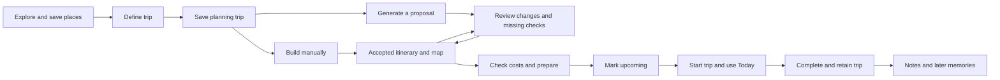
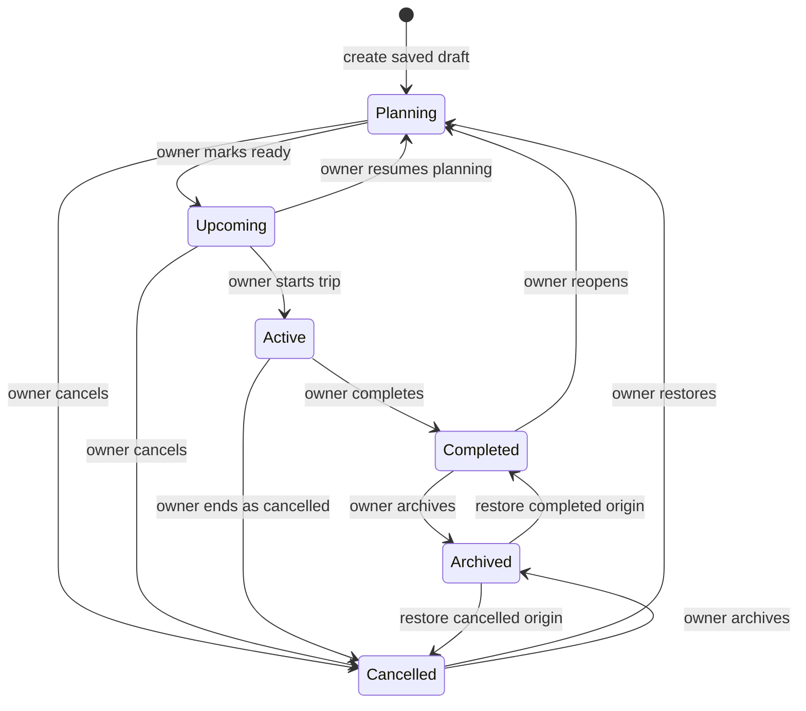
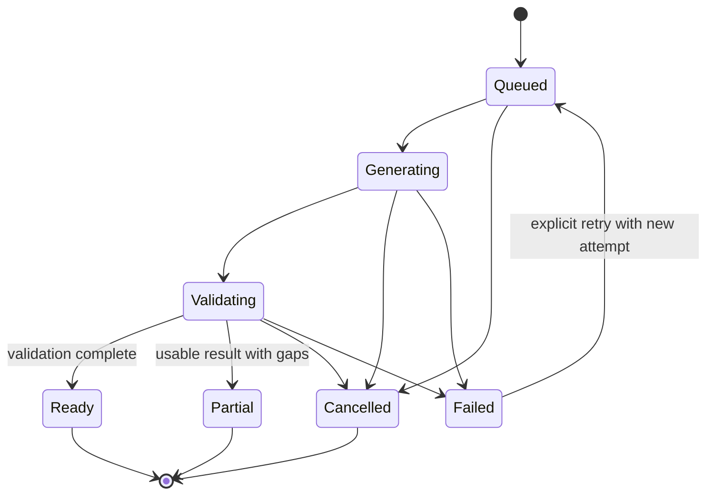
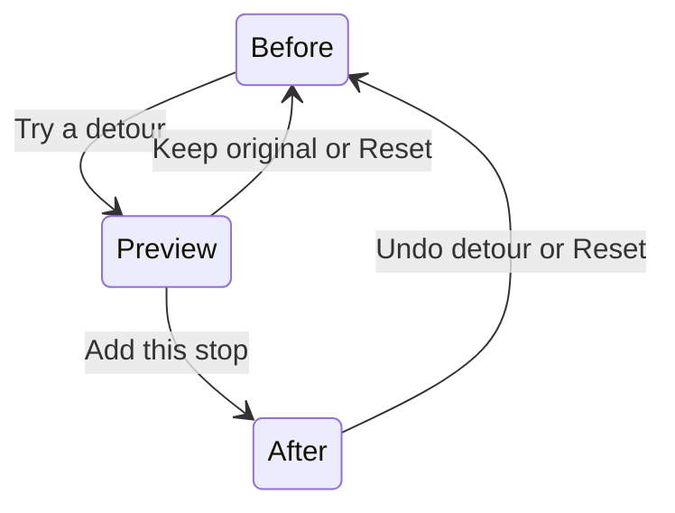
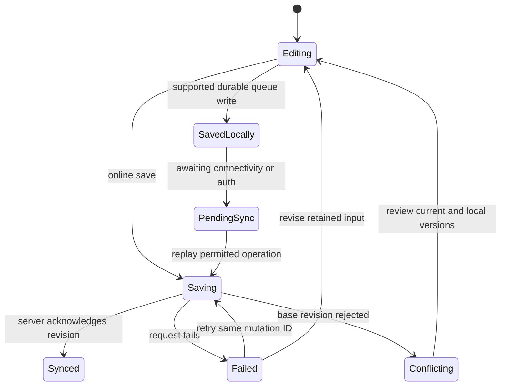

# WanderWay UI/UX Plan

**Date:** 7 November 2026  
**Status:** Revised after design review and the owner's request for an exceptional, strictly 3D-free experience; application implementation remains pending.  
**Recommended direction:** Field Atlas — an editorial travel journal built around the traveller's own decisions.  
**Quality target:** Outstanding visual craft, usability, originality and content, demonstrated through the acceptance gates below. “10/10” is an ambition, not a verified score or an award guarantee.  
**Goal:** Help a traveller turn an idea into a usable, editable trip, understand what still needs checking, and carry the same plan into the journey.  
**Architecture:** One connected trip record with an itinerary/map workspace and separate financial, booking, generation, and synchronisation states. Public discovery is expressive; authenticated workspaces prioritise legibility and control.  
**Intended stack:** Next.js App Router, React, strict TypeScript, Tailwind CSS, Supabase, official `@google/genai`, and provider-backed places/routes. Versions in the repository are targets, not installed dependencies.  
**Design contract:** [DESIGN.md](DESIGN.md). This plan governs journeys and scope; the contract governs reusable visual and interaction decisions.

## Contents

1. [Product and repository evidence](#1-product-and-repository-evidence)
2. [Journey, navigation, and state models](#2-journey-navigation-and-state-models)
3. [Visual directions and recommendation](#3-visual-directions-and-recommendation)
4. [Screen inventory and release boundaries](#4-screen-inventory-and-release-boundaries)
5. [Screen specifications and wireframes](#5-screen-specifications-and-wireframes)
6. [Trust, money, permissions, and offline contracts](#6-trust-money-permissions-and-offline-contracts)
7. [Interaction specifications](#7-interaction-specifications)
8. [Design system](#8-design-system)
9. [Motion and animation ownership](#9-motion-and-animation-ownership)
10. [Accessibility, performance, and verification](#10-accessibility-performance-and-verification)
11. [Implementation sequence and file previews](#11-implementation-sequence-and-file-previews)
12. [Critique and resolutions](#12-critique-and-resolutions)
13. [Evidence and source register](#13-evidence-and-source-register)
14. [Handoff and acceptance](#14-handoff-and-acceptance)

## 1. Product and repository evidence

### 1.1 What exists

Inspected the root documents, repository file inventory, all five `.agents/rules` files, the requested design/domain skills, and their applicable references. Neither `.env` nor its values were read. No provider account, live database, installed application, or credentials were tested.

| Evidence | Finding | Design consequence |
| --- | --- | --- |
| `AGENTS.md` | Responsive web, strict TypeScript, React, Tailwind, Supabase/PostGIS/RLS, Gemini and verified location services | Design for browsers, keyboard and touch; keep deterministic calculations outside components |
| `PROJECT_STATUS.md` | Foundation prepared; next step is scaffolding; targets Next.js 16, React 19, Tailwind v4 and Lucide | Greenfield product design, not a reskin of an existing UI |
| `IMPLEMENTATION_PLAN.md` | Intended App Router routes, schema blueprint, grounding pipeline and eight engineering phases | Reuse route vocabulary and directory boundaries; identify missing contracts before implementation |
| `WanderWay-PRD.md` | Reliable core in 3.0; preparation/collaboration expansion in 3.1; advanced assistance in 3.2 | Deliver a working central workspace before exposing secondary tools |
| `README.md` | Describes React/Vite, Express, Firebase, MongoDB, local uploads and working features | Retired documentation; not evidence of current functionality |
| File inventory | No `src/`, app routes, `supabase/`, tests, package manifest, lockfile, screenshots, fonts or UI tokens found | All screens and component paths below are proposed; no rendered baseline exists |
| Design contracts | No `DESIGN.md` or `UI_UX_PLAN.md` existed at inspection | Create these two files; preserve other documents and existing untracked skill directories |

**Inventory update, 7 November 2026:** the table above records the original planning inspection. A subsequent inspection found a package lock, generated build artifacts and an unused 3D experiment in `assets/3d/` and `public/assets/3d/`, but still no application package manifest or source routes. At the owner's request, the entire experiment directories were removed after the model/preview cleanup was verified. No external project reference to those files was found. This revision uses no assets or generators from that experiment.

Cleanup verification: 322 experiment files were removed, including 21 model/preview files and all 12 experiment PNGs, freeing 112,138,304 bytes. Neither experiment directory remains. Public delivery contains no experiment assets.

The intended architecture is Next.js/React/TypeScript/Tailwind/Supabase. Nothing in this checkout demonstrates an implemented authentication flow, itinerary editor, provider integration, offline cache, or collaboration feature. The status document's infrastructure/configuration statements are documentary claims, not connection verification. Next.js 16 and named Gemini models must be checked for support, security and provider availability when implementation begins; this plan does not declare them the latest versions.

### 1.2 Conflicts and gaps to reconcile before coding

| Conflict or gap | Proposed resolution, without changing the source documents in this task |
| --- | --- |
| README advertises retired infrastructure and shipped functionality | Replace its setup/features description in the future foundation task after an actual runnable app exists |
| Architecture roadmap puts shared expenses and vault into its eight phases, whereas PRD release scope defers them | Treat engineering phases as dependency order, not a promise that everything ships in 3.0; use section 4 release gates |
| Architecture says its plan is approved in status, but ends by asking for approval | Treat architecture as intended direction, not proof of implementation or approval of this new visual proposal |
| `minimal-motion.md` calls the product "Atlas" | Apply its behavioural constraints to WanderWay; regard the name as a stale copy reference |
| Short pricing rule/skill lists collapse evidence categories | Preserve all six PRD evidence types, including `verified_range`; never collapse the stored taxonomy |
| Skill references to `docs/specifications/TRIP_LIFECYCLE.md`, budget specifications, and `LIVE_TRAVEL_INTELLIGENCE.md` have no matching files | Define the proposed UX contracts here; reconcile domain specifications in a later engineering task |
| `trips` blueprint has one destination and no explicit destination time zones; PRD permits multiple destinations | First slice supports one resolved destination; public 3.0 must support an ordered destination list before claiming multi-destination planning; retain per-day location/time zone |
| Budget blueprint has one amount and `is_paid`, no bounds/quantities/quote expiry/expense ledger | Do not squeeze ranges, actual spending, refunds and payments into that boolean; specify distinct read models in section 6 and add backend contracts before those screens ship |
| `is_user_edited` cannot express deleted items, base versions or reviewed change sets | Require revision-aware proposals, tombstones and conflict checks; hiding an Apply button is insufficient protection |
| Document matrix grants all trip members read access; PRD requires explicit sharing | Use document-specific audience grants, private storage and permission tests before vault launch |
| Profile blueprint suggests all authenticated users can read profiles containing preferences/home location | Expose only needed member display identity; keep personal profile fields private |
| No persisted generation jobs, notification model, saved-place model or offline protocol in the blueprint | These are dependencies, not UI-only work; no progress, inbox, or saved/synced claim without supporting records |
| Creation blueprint does not distinguish incomplete drafts or displaced-day content | Planning drafts allow missing inputs; add an explicit unscheduled-content contract before structural date/destination editing |

No SQL or database schema is changed by this plan. These gaps are engineering prerequisites, with no backfill required in the observed code-free checkout; any external data discovered later requires its own migration/backfill review.

### 1.3 Audience, circumstances, and success

Primary design target: the person coordinating a solo, couple, family or friends' trip, often planning on a laptop and consulting the plan on a phone. During travel, they may have one free hand, bright daylight, a weak connection and little patience. This is a design hypothesis derived from the PRD, not a claim of conducted user interviews.

The core loop is **make a plan, check its gaps, change it confidently, reopen it when needed**. Success is a retained, usable trip, not the number of AI generations. Family occupancy, children and mobility constraints must remain visible in planning inputs; do not infer access needs or market prices from a traveller persona.

Assumptions made for this proposal:

- Initial interface copy is English; destination names retain native scripts. Layout uses logical properties and must survive long names. Full translation/RTL release coverage is a separate scope decision.
- Use the profile's preferred currency only as an editable initial value. Without a preference, ask for currency; browser locale is not a currency or location decision.
- Authentication precedes cloud trip creation/generation. Public exploration remains open. Returning through sign-in preserves the selected destination and safe return route. Anonymous durable drafts are optional PRD capability, not a launch promise.
- Dates suggest useful actions but never silently activate, complete or cancel a trip. Lifecycle changes belong to the owner.
- Place lookup, routing, quote, weather and alert coverage are independent. A working location API does not establish live transport, traffic, accessibility, price or safety coverage.
- No genuine customer logos, testimonials, booking integrations or product screenshots exist in the checkout. Public design must not imply otherwise.

## 2. Journey, navigation, and state models

### 2.1 Complete journey

| Stage | Traveller's question | Primary surface and action | Trust/recovery obligation |
| --- | --- | --- | --- |
| Discover | Where might we go? | Explore, destination detail, save a place or plan a trip | Provider-backed result identity; editorial context separate from time-sensitive facts |
| Define | What fits our people, time and budget? | Four planning sections; review inputs; create draft | Explicit group/per-person basis, rooms/nights, mobility constraints; retain input |
| Propose | Can I get a useful starting plan? | Generate itinerary or start manually | Actual job stages, cancellation, retry and partial results; no fake completion percentage |
| Validate | What still needs checking? | Review proposal beside affected map/day; accept selected changes | Preserve manual edits; missing prices, unresolved places and timing conflicts remain visible |
| Prepare | What must we arrange? | Overview readiness links, manual bookings; later packing/vault/group | Separate booking, payment and document permissions; no universal readiness score |
| Travel | What is next, and what changed? | Today, itinerary/map, cached essentials; later expense shortcut and expanded alerts | Destination-local date/time, saved snapshot time, unavailable feeds, optional location permission |
| Remember | What did we actually do? | Completed overview, retained notes/costs; later memories and summaries | No invented experiences; completion preserves records; duplicate resets current quotes/bookings |



### 2.2 Navigation architecture

**Global:** Trips, Explore, Saved. Trips also serves the PRD's personalised Home responsibility, avoiding separate Home and Trips screens containing the same list. Notifications and account/settings are labelled utilities. Public navigation is Explore, How it works (an anchor), Sign in and Plan a trip.

**Inside one trip:** Overview, Itinerary, Budget, Prepare, Updates. Map is a view of the itinerary workspace, not a separate data model. Prepare starts with bookings; packing and vault appear only when implemented and authorised. Updates starts with weather and basic trip notifications, later gaining clearly separated feeds. Group is a member control in the trip header after collaboration launches. Companion is a contextual action after its phase, not permanent global navigation.

**Mobile:** replace global navigation with the trip context. One bottom bar contains Plan, Map, Budget, More; Plan opens the itinerary. More opens a sheet titled Trip navigation with Overview, Prepare, Updates and Trip settings. The trip title links to Overview; a back link returns to Trips. Active trips gain a persistent labelled Today shortcut beneath the trip title on local routes; on Today it is the current-page label, not another button. Header overflow is labelled Trip actions, never a second More. Do not stack global and trip bottom bars. Creation/review/full-screen forms replace the bar with their own action row.

**Desktop:** a 208px global sidebar and compact trip navigation row; no second sidebar. The header exposes the trip's state, save status, role and relevant action. Collapse the global sidebar to a drawer before the workspace becomes too narrow. Visible navigation uses links and `aria-current`, not ARIA menu roles.

### 2.3 Proposed route map

Paths without a note align with the architecture blueprint; all are unimplemented. Route groups are not URL segments.

| Route | Responsibility | Availability |
| --- | --- | --- |
| `/` | Public narrative and primary planning entry | 3.0 |
| `/explore`, `/explore/[destinationId]` | Search, discovery and sourced place context | 3.0 |
| `/login`, `/verify`, `/callback` | OTP, Google sign-in, safe callback | 3.0 |
| `/trips` | Home/trips dashboard with state filters | 3.0 |
| `/saved` | Saved places, selected additions to a trip; proposed addition | 3.0 |
| `/trips/new?step=where` | Planning sections: where, people, preferences, review | 3.0 |
| `/trips/[tripId]` | Overview and readiness | 3.0 |
| `/trips/[tripId]/itinerary?day=[dayId]&activity=[id]` | Canonical editor and list selection | 3.0 |
| `/trips/[tripId]/review/[proposalId]` | Initial or selected-day AI proposal; proposed addition | 3.0 |
| `/trips/[tripId]/map?day=[dayId]&activity=[id]` | Map-first entry to the same workspace, retaining selection | 3.0 |
| `/trips/[tripId]/budget?view=plan` | Planned costs, actuals, source details; balances later | 3.0 |
| `/trips/[tripId]/prepare` | Preparation hub; proposed addition | 3.0 |
| `/trips/[tripId]/bookings`, `/bookings/[bookingId]` beneath the trip | External booking records and detail | 3.0 |
| `/trips/[tripId]/intelligence` | Updates with weather and notifications; richer feeds later | 3.0 then 3.1/3.2 |
| `/trips/[tripId]/today` | Operational active-trip view; proposed addition | 3.0 |
| `/notifications`, `/settings`, `/settings/privacy` | Inbox, profile/currency/theme, deletion and local copies; proposed additions | 3.0 |
| `/trips/[tripId]/packing`, `/vault`, `/group` beneath the trip | Preparation, explicit sharing, invitations | 3.1 |
| `/trips/[tripId]/budget?view=balances` | Shared ledger and recorded settlements | 3.1 |
| `/trips/[tripId]/companion`, `/memories` beneath the trip | Contextual assistant and recorded memories | 3.2 |

An activity detail is a 400px desktop inspector or a mobile full-screen sheet with a shareable selection URL. Closing restores the invoking row and scroll. Browser Back closes selection before leaving the workspace. Query state scopes view/selection, never authoritative financial or permission data. Invalid IDs show a recoverable selection error without breaking the saved itinerary.

### 2.4 Independent state machines



| Transition | Guard and side effect |
| --- | --- |
| Create saved draft | Authenticated owner and stable request ID; destination, dates and party/budget inputs may be absent. Validate any supplied typed values, but do not require a generation-ready trip. Show incomplete fields on the dashboard and resume the draft |
| Generate or start a dated manual itinerary | Require resolved destination(s), valid ordered date range and valid party inputs; occupancy is required only for requested overnight accommodation planning, never for a basic manual day. Budget may explicitly remain unset. Review missing fields before proceeding; draft saving is independent of this guard |
| Planning to Upcoming | Saved itinerary (manual or accepted proposal), valid dates and counts; owner acknowledges remaining unresolved checks. Unknown prices do not force a fabricated budget or block this transition |
| Upcoming to Active | Owner explicitly starts; show trip-local date and confirm if starting outside its dates; do not infer physical presence |
| Active to Completed | Owner confirms; retain bookings, costs, documents, notes and history; no automatic settlement or provider cancellation |
| Reopen or restore Cancelled | Confirm purpose, record transition history and invalidate affected operational checks; never restore a cancelled supplier reservation |
| Archive/restore | Only Completed or Cancelled can archive; retain origin state and restore to it. Active trips must first complete/cancel |
| Cancel | Explain that WanderWay changes the trip record only; externally cancel bookings through their provider. Retain the cancelled record |

Only owner lifecycle actions are available in this proposal. Legal transitions re-check current revision and permissions server-side; repeated requests produce one transition/history event. Failure leaves the prior state visible with the attempted action and retry. Date, destination, traveller or transport changes identify exactly which routes, forecasts and quotes need revalidation. Duplication creates Planning with new IDs, retains selected notes/preferences, and excludes actual expenses, payment claims, booking confirmations, member grants and sensitive documents.

**Structural trip edits:** only the owner changes the trip date range or destination structure in this proposal. If accepted days/activities already exist, show Review trip changes before applying. Preview old/new dates, destination assignments, affected days, notes, routes, quotes and booking links. For a shifted range, explicitly offer Shift planned days while keeping intended local times or Keep existing calendar dates; neither happens silently. For removed/out-of-range days or removed destinations, the owner chooses destination days/placements or Keep unscheduled for the affected content. An Unscheduled section retains stable activity identity, original day/date, day notes and all existing links until the owner assigns or deliberately removes it. It is always reachable from the day selector and Overview's unresolved checks; it has no invented date or map position.

Apply the reviewed structure/content mapping atomically against the current revision. A concurrent edit returns to review. Preserve original booking dates, expense dates, payments and their record links; flag Outside trip dates or Destination needs review rather than moving or deleting external/financial records. Only affected routes/forecasts/quotes become stale, and pending proposals based on the replaced structure become Superseded with history retained. Upcoming returns to Planning as an explicit previewed side effect; Active remains Active after explicit owner review, while Completed/Archived must be reopened/restored first. Structural edits remain online-only even when later activity mutations can queue. No removed day silently deletes user work.



Generation job and proposal are separate. Proposal states are Pending review, Applied, Rejected and Superseded; a completed job never auto-applies a proposal. A retry references the previous attempt but has a new attempt ID. Duplicate delivery of the same attempt does not create a second result. Cancelling stops application of late results even if an upstream request cannot be aborted. Existing accepted plans stay readable during all job states.

Bookings follow the PRD's Idea, Researching, Price selected, Booking in progress externally, Booked, Changed, Cancelled and Completed. Price selected can advance to externally in progress, then Booked only after explicit user/provider confirmation; failure or abandoned provider navigation returns to Researching. Booked can become Changed, Cancelled or Completed with recorded provenance. Changing a record does not change the supplier reservation. Payment separately records Unknown, Unpaid, Part paid, Paid or Refunded, with actual transactions. Quote freshness separately records Current, Stale, Expired or Unavailable. A pending refresh is a request state, not a new evidence type.

## 3. Visual directions and recommendation

Reading this as a travel planning product for people who need inspiration before departure and precision while travelling. The public website can feel like a contemporary travel guide; the working application must remain a recognisable planning tool.

### 3.1 Three different structures

| | A. Field Atlas | B. Departure Board | C. Open Road |
| --- | --- | --- | --- |
| First viewport | Trip/day heading, editable itinerary at left, selected day's map at right | Time-first timetable, unresolved-check queue, compact booking/transport rows | Large map canvas, selected stop inspector, horizontal day shelf |
| Navigation model | Trip sections with list/map view continuity | Task queue and day/time filters above a tabular workspace | Destination/route layers and map selections; list is an alternate full view |
| Visual language | Cool mineral surfaces, lagoon ink, documentary photography; numbered route spine | Off-white/ink timetable, signal yellow reserved for attention; IBM Plex Sans and tabular figures | Blue-white canvas, cobalt controls, expansive scenery in discovery; a single sans family |
| Signature | Identical waypoint numbers in itinerary, map and Today; a quiet vertical route connection | Scheduled time, transit buffer and booking time align into a clear timetable rhythm | A spatial route and persistent selected-stop shelf orient the traveller |
| Mobile adaptation | One-column day list; Map is an explicit alternate view; inspector becomes full-screen | Rows become stacked time/description records; dense filters require disclosure | Map with selected-stop bottom panel; list fallback is essential for editing |
| Best fit | Mixed planning, personal edits and in-trip use | Frequent travellers with transport-heavy, tightly scheduled trips | Early exploration and road trips with a strong spatial mental model |

### 3.2 Comparison

These are qualitative design judgments, not measured research scores.

| Criterion | Field Atlas | Departure Board | Open Road |
| --- | --- | --- | --- |
| Traveller needs | Broad fit across discovery, planning and daily use | Excellent schedule scanning; weak exploratory warmth | Strong geographic exploration; weaker time/cost comparison |
| Trust | Inline uncertainty beside the affected activity and price | Exception queue is precise; could imply excessive operational authority | Map precision can overstate unresolved places and route certainty |
| Mobile usability | Familiar list, reachable actions, no mandatory gesture | High information density costs scanning and form space | Map panning competes with scrolling; bottom panel can hide geography |
| Density | Adjustable by screen and task; few necessary containers | Most efficient at desktop; hardest to retain at 320px | Spacious map, low density for editing several activities |
| Accessibility | Linear reading order and non-map equivalent built into structure | Tables are feasible but responsive transformations need care | Equivalent list and location controls add substantial work |
| Implementation cost | Moderate: one shared itinerary/map workspace | Moderate: timetable, responsive records and keyboard/filter complexity | Highest: map-state coordination, panel gestures and spatial edge cases |
| Distinctiveness | Travel character through content and cross-referenced waypoints | Memorable but risks an airport/control-room costume | Visually recognisable but resembles many map/booking apps |

**Recommend Field Atlas.** It supports the full journey without making geography, AI chat or dashboard metrics the organising principle. The same numbered activity remains recognisable after moving between list, map and Today. It also works when the map/provider fails.

### 3.3 Resolve conflicting aesthetic advice

- Use master-ui to coordinate the system and the six specialists for task research, precedents, measured pairs, text roles, components and review gates.
- Apply impeccable's distinction between persuasive public surfaces and operational workspaces. App layouts come from the task; the atlas reference contributes palette, type and one route-numbering motif, not paper texture or ornamental cartography.
- Apply design-taste-frontend to public composition only. Its own scope excludes dashboards and multi-step forms. Do not import its stock motion intensity, mandatory imagery generation, decorative bans or icon preferences as universal product rules. Lucide is the project's documented icon choice.
- Local ui-ux-pro-max travel records recommend aurora/organic styles and motion-heavy storytelling. Reject those effects here because the project explicitly requires calm, minimal motion. Retain useful focus, error-summary and non-drag interaction recommendations. Its Python launcher was unavailable; inspected relevant local CSV records directly with native shell tools instead. No generated design-system output is treated as authoritative.
- A readable serif is purposeful on travel storytelling and trip names, not financial tables or controls. Newsreader has an editorial reading role; Public Sans carries the application. This is a deliberate guidebook association, not a generic luxury pairing.
- Use one action color, with separate semantic status colors. Multiple status hues communicate meaning; a marketing rule about one accent must not erase error/warning distinctions.

### 3.4 Expressive public website, focused application

Public composition: a left-aligned two-line Newsreader headline, one CTA and a wide documentary landscape offset beneath/alongside the text. Proposed headline: **Leave room for the detour.** Supporting copy: **Shape your days, check the details, and keep the plan close.** Primary action: **Plan a trip**. At 1366x768, both copy and CTA fit without waiting for motion. On mobile, copy and CTA precede an aspect-ratio-reserved photo.

Follow with one editorial destination spread, one truthful itinerary demonstration, one annotated explanation of price evidence, and a concise planning entry. Vary composition rather than repeating three feature cards. Until real screens exist, label a demonstration "Illustrative trip" and never present a wireframe as a shipped screenshot. Publish only implemented capabilities. No fabricated reviews, user counts, partner logos or urgency counters.

Application composition: modest headings, solid surfaces, stable rows, photos only where they help recognise a destination/place. No photo backgrounds behind costs, alert instructions, form fields or editor controls. No decorative contour lines, passport stamps, fake boarding passes, chat bubble clutter or ambient animation.

### 3.5 Non-negotiable visual direction: no 3D

Use semantic HTML, CSS layout, real photography and flat SVG diagrams. No 3D models, GLB/GLTF/OBJ/FBX/USDZ assets, Blender exports, model viewers, Three.js, React Three Fiber, Spline embeds, decorative WebGL scenes, simulated terrain, 3D-rendered PNG substitutes or perspective-tilted UI. A geographic map is a functional, flat 2D view; disable terrain, extrusions, pitch and globe mode. A provider's internal GPU renderer is not permission to introduce 3D content. Never load a map library for the public illustration.

The distinctive thread is **a plan with room for your decisions**. Use ordered waypoint numbers, an aligned time column and a short human day note across the public example, itinerary and Today. Numbers communicate the current order; stable internal IDs retain identity after reordering. This repeated information structure creates recognition without decorative cartography. Primary lagoon actions, copper editorial annotations and Newsreader headlines follow DESIGN.md; introduce no competing accent palette.

Direction decision: retain and deepen Field Atlas. A generic feature-card page would under-express the product; a cinematic 3D experience conflicts with the owner's instruction and the fast, accessible planning task. Distinctiveness must come from composition, content and the editable-day demonstration.

### 3.6 Public homepage: complete composition and content brief

Visitor outcome: understand that WanderWay helps them shape an editable trip, see how their choices stay authoritative, then choose Plan a trip. Public mode is Persuade; the application remains Operate. These are proposed launch contents, gated on the corresponding shipped capabilities.

| Section | Exact content and visual job | Desktop composition | Mobile composition |
| --- | --- | --- | --- |
| Header | WanderWay wordmark; Explore; How it works; Sign in; Plan a trip | 64px minimum height; content aligned to the public grid; text wordmark until original identity is designed | 56px minimum; wordmark and labelled Menu; expanded menu uses ordinary links and visible Close; hero owns the initial CTA |
| Hero | Eyebrow: A plan that stays yours. H1: Leave room for the detour. Body: Shape your days, check the details, and keep the plan close. CTA: Plan a trip. Secondary text link: See a day change | Twelve-column grid inside 80rem: copy spans columns 1–5; photograph spans 7–12 and begins 48px below the headline top. Newsreader follows the 64px desktop token. No text overlays the photo. CTA visible at 1366x768 | Single column, 16px gutter; 40px headline wraps naturally; copy and CTA before a 4:3 crop. No fixed viewport height, forced line count or sticky marketing CTA |
| Destination spread | H2: Start with a place. Make it your own. One Mysuru editorial feature with verified location caption and Explore Mysuru link; copy focuses on the illustrated day, without unsourced opening hours or prices | Reverse the hero balance: one 3:2 photo spans seven columns, a short editorial note spans four with one empty column; 96px section separation | One image, caption, heading, short note and link; 64px separation; no carousel or horizontal swipe requirement |
| Interactive day | H2: Change one stop. Keep the day yours. Supporting copy: Try a detour in this illustrative day. The section contains the exact demonstration in 3.7 | Flat schedule occupies seven columns; optional schematic occupies five; section heading aligns with schedule, not a separate card header | Schedule first; schematic follows only when useful. All controls are visible and usable without hover. The static comparison remains available |
| Trust explanation | H2: Know what still needs checking. Three short rows: Your changes stay yours; Missing prices stay visible; Check the source. Each points to a concrete labelled example | One annotated itinerary/cost example plus adjacent explanation; rows and dividers, no three-card grid or blanket verified badge | Example followed by the three explanations. Essential unknown labels remain inline; source detail uses a labelled disclosure |
| Closing invitation | H2: Make space for your kind of day. CTA: Plan a trip. Support: Start with a draft. Change it as you go | Quiet typography-led band, normal canvas and one CTA; no second hero image | Same reading order; full-width CTA within content gutter |
| Footer | Explore, How it works, Sign in, Privacy and Terms; only published destinations and real legal routes | Simple grouped links and wordmark; no fabricated partners, testimonials, counters or compliance seals | Natural wrapping groups; no accordion for a handful of links |

```text
DESKTOP / — editorial, flat, no canvas or 3D
WanderWay                  Explore  How it works    Sign in  [Plan a trip]

A PLAN THAT STAYS YOURS                 [documentary Mysuru photograph]
Leave room for                         [natural light, specific place]
the detour.                            [caption outside the image    ]
Shape your days, check the details,
and keep the plan close.
[Plan a trip]  See a day change

[destination spread: real photo       ]    Start with a place.
[                                    ]    Make it your own.

Change one stop. Keep the day yours.
[editable illustrative day            ]    [flat schematic, optional]
[Try a detour] [Reset example]             [Illustration, not a route]

[specific trust example               ]    Know what still needs checking.
Make space for your kind of day.           [Plan a trip]
```

```text
MOBILE / — ordinary vertical scroll
WanderWay                         [Menu]
A PLAN THAT STAYS YOURS
Leave room for the detour.
Shape your days, check the details,
and keep the plan close.
[Plan a trip___________________________]
See a day change
[documentary photo, reserved 4:3 crop   ]
Mysuru — factual caption and credit
[destination spread and editorial note]
Change one stop. Keep the day yours.
[illustrative schedule and detour      ]
[trust example and explanations        ]
Make space for your kind of day.
[Plan a trip___________________________]
[ordinary footer links                ]
```

**Photography commissioning brief:** hero subject is a ground-level human-scale view of Devaraja Market, Mysuru, with a clear walking path and natural daylight; supporting spread is a recognisable street-level Mysuru Palace exterior with room for its architectural silhouette. These are acquisition briefs, not claims that licensed files have been acquired. Select images from an identified photographer/library with documented web usage rights, verified location, alt description, credit requirements and separate desktop/mobile focal crops. Reject aerial renders, oversaturated stock collages, embedded captions and heavy text-obscuring grading. No hero asset may be published before its rights/location checks pass. During development use an intentional solid reserved area with the location title, not an unrelated photograph.

Future asset records live in `src/content/marketing/media.ts` with source URL, creator, licence reference, verified place label, width/height, alt text, credit and crop positions. Store only selected delivery variants under `public/images/editorial/`; do not duplicate full-resolution masters into public output. Prefer AVIF/WebP with a required compatible fallback; allow PNG only for a future functional asset that truly requires it. No PNG from the deleted 3D experiment is reusable.

### 3.7 Signature interaction: a detour you control

Build this as an accessible 2D example using real HTML rows and optional SVG. It is an illustrative fixture, never a live route, generated recommendation or saved user trip. No provider requests, AI call, credentials, storage writes or geographic coordinates are needed. If the schematic is shown, label it Illustration, not a route; the schedule conveys all essential information.

| Beat | Visible state and action | Information the visitor learns |
| --- | --- | --- |
| Before | Three rows: Mysuru Palace; Devaraja Market; Lunch with the group. The lunch row carries Your note: Keep lunch together. Button: Try a detour | A day has structure and a personal decision worth retaining |
| Preview | Clicking Try a detour expands one candidate, A café break, between market and lunch. Label Proposed stop; copy This example adds a stop without choosing real travel times. Buttons: Add this stop; Keep original. Focus moves to the preview heading | Changes are proposals; no edit happens silently and no fabricated routing/timing is introduced |
| After | Add this stop inserts the fourth row, renumbers the displayed sequence and retains the lunch note verbatim. Announce Stop added to this example. Your lunch note is unchanged. Buttons: Undo detour; Reset example | The traveller owns the change; identity and notes survive the new order |

Undo restores the exact before state; Keep original dismisses preview and restores its trigger focus; Reset restores all fixture state and focuses Try a detour. Repeated activation cannot duplicate the stop. Controls have stable hit areas and meaningful names. All phases wait for explicit input and persist until the next action; no autoplay, timed reading, scroll trigger, fake typing or automatic advance. Without JavaScript show the before/after comparison and the same explanatory text. A native disclosure can expose the static comparison even with JavaScript enabled.

CSS may fade the changed highlight for <=160ms and translate the newly inserted visual wrapper by <=8px; no layout animation is needed. Reduced motion is instant. The demonstration requires no GSAP dependency. The optional marketing animation described in section 9 must never replace these controls or delay logical state. Product-specific content, user agency and typographic composition provide the memorable moment.



## 4. Screen inventory and release boundaries

**Priority definitions:** P0 is the first internal vertical slice, not a public MVP. P1 completes the public reliable-core 3.0 release. P2 corresponds to 3.1 expansion; P3 corresponds to 3.2. A P0 demo must not advertise the full PRD. All P1 items are required before claiming the 3.0 core is complete.

| Screen/flow | Priority/release | Dependencies and scope |
| --- | --- | --- |
| Shell, empty trips dashboard, profile/currency/theme | P0 | Tokens, routing, authentication, private profiles |
| OTP, Google, verification/recovery, sign out | P0 | Configured Supabase Auth; real expiry/rate-limit states |
| Trip creation and saved draft | P0 | Validated dates/counts, private persistence, owner access |
| Manual itinerary, activity editor, accessible move/delete | P0 | Revision-aware writes, dependent-route invalidation |
| Trip overview/readiness and lifecycle dialogs | P0 then P1 completion | Persisted trip state/history; readiness is explicit checks |
| AI generation, partial result, proposal review and selected-day changes | P1 / 3.0 | Grounding pipeline, job state, revision-aware proposals |
| Map/list workspace and place details | P1 / 3.0 | Resolved identities/coordinates, licensed map tiles and routing |
| Budget plan, personal actual spending, amount/source details | P1 / 3.0 | Evidence model, deterministic money/FX, separate actual records |
| Public landing, Explore, destination search/detail | P1 / 3.0 | Real editorial content, place provider, licensed images |
| Saved list, add saved places to trip | P1 / 3.0 | Per-user saved records, duplicate detection |
| Manual booking list/detail and preparation hub | P1 / 3.0 | External provenance, lifecycle and budget linkage |
| Weather and Updates | P1 / 3.0 | Correct destination/date forecast coverage, timestamps and failure contracts |
| Basic notification inbox/preferences | P1 / 3.0 | Persistent events/read states, idempotent delivery; in-app first |
| Today, completed trip, archive/cancel/restore | P1 / 3.0 | Trip-local date/time, retained records and guarded transitions |
| Essential offline snapshot, download/remove/status, offline shell | P1 / 3.0 | Account-scoped storage, cache expiry/eviction handling; read-only |
| Privacy/account deletion and pending outcome | P1 / 3.0 | Backend deletion policy; explanation of owned/shared data consequences |
| Packing and suggested items | P2 / 3.1 | Editable list; weather provenance or explicit assumptions |
| Vault upload/detail/download/audience picker | P2 / 3.1 | Private buckets, document-specific grants, upload validation |
| Members/invites/roles, activity comments/suggestions | P2 / 3.1 | Membership enforcement, revocation, version conflict handling |
| Shared expenses/custom splits/balances/settlements | P2 / 3.1 | Membership and financial ledger, immutable history/idempotency |
| Supported queued edits and conflict centre | P2 / 3.1 | Durable outbox, base revisions, per-entity conflict policies |
| Official alerts and authorised transport/road feeds | P2 then P3 | Geography-specific contracted providers, matching, expiry/deduplication |
| Contextual companion, broader intelligence | P3 / 3.2 | Permission-filtered trip context, source retrieval, existing change-review UI |
| Memories, media, actual-trip summaries | P3 / 3.2 | Recorded experience data, private media handling |
| Voting, proactive monitoring, advanced offline maps | P3 or later | Explicit scope, provider/platform capability and opt-in |

Do not render disabled future tabs to advertise the roadmap. Empty implemented features explain how to begin. Unsupported capabilities remain absent; missing provider data inside a supported feature gets a truthful unavailable state.

## 5. Screen specifications and wireframes

### 5.1 Shared responsive rules and illustrative content

Wireframes below specify structure, not rendered mockups. Desktop examples assume 1440x900; mobile examples assume 390x844. Validate at 320px, 375px, 768px, 1024px and a 1366x768 laptop as well. Desktop workspaces use a 208px global sidebar, a flexible content region and, when space permits, a map at least 360px wide. Below 1200px the sidebar collapses; below 1024px list and map become explicit alternate views. No shrunken desktop split on phones.

One page scroller is the default. Desktop editor may have independently labelled list/map areas; avoid nested scrollers on mobile. A sticky map below the compact header is allowed, with no scrolling interception. At short landscape heights, release nonessential sticky chrome. Use `min-height: 100dvh` only where needed; never force a marketing hero or form to occupy the viewport.

**All named travellers, future dates, amounts, timings, provider-state examples and messages in this plan are illustrative fixtures, not live travel advice or prices.** Sample: “A long weekend in Mysuru”, Bengaluru to Mysuru, 12-15 February 2027, three adults, two rooms, four calendar days/three nights. Riya, Kabir and Meera are fictional travellers. Activity times are proposed schedule times, not verified opening hours. No coordinates, current weather, ticket availability or reservations are asserted.

Sample money is user-entered or derived from those inputs: budget target INR 24,000 (`user_entered`); room allowance INR 2,200 per room/night (`user_entered`), calculated accommodation INR 13,200 for three nights/two rooms (`calculated_estimate`); food allowance INR 450 per adult/day (`user_entered`), calculated food INR 5,400 for three adults/four days (`calculated_estimate`). Known planned costs INR 18,600 and equal planning allocation INR 6,200/person are `calculated_estimate`; transport and entry tickets remain `unknown`. Values are personal allowances, not supplier rates.

### 5.2 Trips dashboard

Purpose: reopen the right trip or resume unfinished planning. Hierarchy: active trip first, next upcoming trip, then planning trips and filtered history. A first-use page has one clear Plan a trip action, an Explore link and a short explanation. Do not show zeros for imaginary analytics.

Populated trip rows show title, destination, dates, lifecycle label, next useful action and unresolved-check count with specific meaning. The featured trip can have one 3:2 destination photo; remaining trips use efficient rows. Persistent save failures appear above the affected trip, not as a global success toast. Search filters title/destination; lifecycle filters include Cancelled and Archived under History.

```text
DESKTOP /trips
+-------------------------------------------------------------------------------------+
| WanderWay       | Your trips                                      [Plan a trip]      |
| Trips           | [Search trips________________]  State [All v]                     |
| Explore         |                                                                   |
| Saved           | NEXT UP                                                           |
|                 | [Mysuru photograph]  A long weekend in Mysuru                      |
|                 |                      12-15 Feb 2027 | Upcoming | 3 adults           |
|                 |                      2 cost categories need checking              |
|                 |                      [Open trip]                                  |
|                 |                                                                   |
|                 | Planning                                                          |
|                 | Kochi at an easy pace   Dates not set    [Continue planning]       |
|                 |                                                                   |
| Notifications   | [History: Completed / Cancelled / Archived]                       |
| Account         |                                                                   |
+-------------------------------------------------------------------------------------+
```

```text
MOBILE /trips
+------------------------------------+
| WanderWay                 [Account]|
| Your trips          [Plan a trip]  |
| [Search trips___________________]  |
| State [All v]                     |
| [Mysuru photograph_____________]  |
| A long weekend in Mysuru          |
| 12-15 Feb 2027 | Upcoming          |
| 2 cost categories need checking   |
| [Open trip____________________]   |
| Planning                         |
| Kochi at an easy pace             |
| [Continue planning]              |
| [View history]                   |
| Trips        Explore       Saved |
+------------------------------------+
```

Mobile uses the global three-link bar only outside a trip. Long titles wrap; dates and state never overlay the photo. Loading reserves the featured area and two rows with static placeholders. No matches preserves filters and offers Clear filters; cloud failure retains a labelled offline snapshot if available. An unauthorised trip never appears through cached cross-account data.

### 5.3 Planning flow

Purpose: gather enough reliable inputs without making users complete a travel survey. Four sections use real labels: **Where and when**, **Travellers and budget**, **Preferences**, **Review inputs**. A text section indicator is clickable for already visited sections; no fake generated-plan preview appears beside incomplete inputs.

Where and when: title optional initially, starting place, ordered destinations, departure/return local dates. People/budget: adults, children/age brackets only when required, rooms/occupancy, currency, amount and required group/per-person basis, inclusions/exclusions. Preferences: relaxed/balanced/full pace with plain descriptions, interests, transport preferences, mobility/dietary notes with privacy guidance and an optional-field label. Do not claim that selecting “step-free” verifies a place's accessibility.

**Progressive disclosure contract:** initially show destination and dates in section 1; Add another destination and Add a starting place reveal optional fields, and trip title remains optional. Section 2 initially shows adult count, Add children, and two explicit choices: Set a budget / I haven't set a budget. Budget choice reveals currency, amount and group/per-person basis; allowances/inclusions/exclusions live under Budget details. Collect rooms/occupancy only when overnight accommodation planning is requested; ask ages only where a supported service requires them. Required generation inputs remain the section 2.4 guard, and unresolved conditional occupancy blocks only the accommodation-dependent generation request. Never silently infer a budget or occupancy. Section 3 offers optional pace/interests and a visible Skip preferences action; transport/access/dietary notes are labelled optional disclosures. Review consolidates the user's choices with inline Edit links. Keep Save draft and exit visible throughout; remembered values do not disappear when disclosures close.

Review shows an editable summary, derived days/nights, group interpretation, missing inputs and known provider coverage. Primary action is Generate proposal; secondary is Start manually. Trip draft saves through explicit section continuation with a confirmed save state. Back preserves input. Returning users resume the last incomplete section.

Save draft and exit is available on every section, including before dates or destination are chosen. Missing values remain absent, and only supplied values undergo type/range validation. Save and continue preserves completed inputs; Review inputs lists unresolved requirements. Generate proposal and Start manually require the complete destination/date/party guard in section 2.4; an incomplete draft can still be saved and reopened. Malformed values remain in the open form with errors instead of being coerced into invented defaults. The dashboard's Dates not set row is therefore a valid saved Planning draft, not a generation-ready itinerary.

Initial section 2 shows Adults, Add children, Include overnight accommodation, Set a budget / I haven't set a budget, and Save and continue. Accommodation and budget are explicit choices. The following desktop/mobile wireframes illustrate the **expanded state after choosing accommodation and Set a budget**; they are not the initial field density. Preserve these choices and any entered values when returning to this section.

```text
DESKTOP /trips/new?step=people
+-------------------------------------------------------------------------------------+
| [Back to trips]                      New trip                    Draft saved        |
| Where and when > Travellers and budget > Preferences > Review inputs                 |
|                                                                                     |
| Travellers and budget                           YOUR INPUTS                         |
| Adults [3]   Children [0]                       Bengaluru to Mysuru                  |
| Rooms  [2]   [Occupancy details]                 12-15 Feb 2027                       |
|                                                 4 days / 3 nights                   |
| Currency [INR v]   Budget amount [24,000]                                            |
| Budget basis (*) Whole group ( ) Per person      Budget is a personal target,         |
| Included [Stay] [Food] [Transport]               entered by you.                     |
| Exclusions [________________________]                                               |
|                                                                                     |
| [Back]                                                   [Save and continue]        |
+-------------------------------------------------------------------------------------+
```

```text
MOBILE planning section 2
+------------------------------------+
| [Exit] New trip       Draft saved |
| Travellers and budget            |
| Section 2 of 4                   |
| Adults [3]      Children [0]     |
| Rooms [2]                       |
| [Occupancy details]             |
| Currency [INR v]                |
| Budget amount [24,000________]   |
| Budget basis                    |
| (*) Whole group                 |
| ( ) Per person                  |
| Personal target, entered by you |
| Inclusions [Edit]               |
|                                 |
| [Back]       [Save and continue] |
+------------------------------------+
```

Date inputs remain usable without a complex calendar; use labelled date fields with an optional accessible picker. Native selects suit currency/basis; place lookup uses the specified combobox pattern. Validate return-before-departure, zero adults where unsupported, impossible occupancy and ambiguous destination identity. Do not invent provider age cutoffs; collect required ages in the relevant quote flow later. Unknown budget is allowed with “I haven't set a budget”; amount then remains null, not zero. Do not silently cap long trips; show the actual generation limit from the configured service and offer a manual plan if exceeded. On failure, focus a linked error summary after submit and retain all fields. Sign-in expiry returns to the same safe draft after reauthentication.

### 5.4 Itinerary review and editor

Review is a deliberate decision surface, distinct from the accepted itinerary. Header: “Review proposed itinerary”, input summary, grounding result and unresolved checks. Initial proposals show all proposed activities; later proposals show additions, removals, moves, changed times and changed cost assumptions relative to the accepted version. Place resolution, price evidence and freshness have separate labels. Never use one green “Verified” badge for the entire plan.

Editor hierarchy: day navigation, date/location, explicit check summary, ordered activity list, route legs, Add activity. Activity rows show time, waypoint number, title, duration, evidence/booking requirement where known and More actions. A priority or manual-change marker appears only when true. Details reveal notes, source records, route recalculation and edits. No drag-only control or decorative photo per row.

```text
DESKTOP /trips/[id]/review/[proposalId]
+-------------------------------------------------------------------------------------+
| [Back to trip] Review proposed itinerary                   [Discard proposal]        |
| 8 places resolved; 1 needs a location. Costs incomplete.                             |
| Day [12 Feb v]          [Only changes]                                               |
| PROPOSED DAY 1                          | SAME DAY MAP                              |
| [x] 09:00  1 Mysuru Palace               | [1]                 [2]                  |
|     AI suggestion; opening hours unknown|          provider map                     |
| [x] 11:30  2 Devaraja Market             |                                           |
|     Your visit duration is preserved    | Unresolved item has no invented pin       |
| [ ] Remove your lunch stop              |                                           |
|     Manual item; explicit approval only | [View list] [Fit selected day]             |
|                                         |                                           |
| Selected changes: 2                     | Source detail for selected item            |
| [Keep current plan]                        [Apply selected changes]                  |
+-------------------------------------------------------------------------------------+
```

```text
MOBILE itinerary editor
+------------------------------------+
| [Trips] Mysuru     [Trip actions] |
| Planning | Synced                |
| [12 Feb v]         [Review checks]|
| Day 1, Mysuru                    |
| 1 route leg needs refreshing     |
| 09:00  (1) Mysuru Palace          |
| Duration 90 min | Hours unknown  |
| [Details] [Move] [More actions]  |
| Route: needs refresh [Retry]     |
| 11:30  (2) Devaraja Market        |
| Duration 60 min | Edited by you  |
| [Details] [Move] [More actions]  |
| [Add activity________________]   |
| Plan       Map     Budget   More |
+------------------------------------+
```

The desktop review also becomes a one-column mobile page: Current and Proposed appear sequentially for each changed field, not side-by-side compressed columns. A sticky Apply selected changes row shows selection count and unresolved conflicts; it never hides the last item. Fast day switching is immediate and restores each day's selection/scroll. Zero activities offers Add activity and Generate this day, with no implied mandatory generation. Large plans use a day selector and explicit day list, not an endless chip strip. Keep the current day editable while another proposal generates, with revision checks before apply.

**Density and visual proof:** at 1440px, use the 208px shell, a single trip header, day selector and 55/45 list/map split. Align time, waypoint and title into stable columns; keep one dominant action per row and secondary editing in Details or Actions. The selected row uses selected-bg plus an outline, never elevation. At 390px, show the selected day, the next useful action and one grouped check summary before the list; do not repeat the same warning in a banner and every row. A blocking save/permission error stays persistent; next-action warnings stay by their affected activity; secondary source metadata sits behind a labelled Details action. Price evidence and unknown amounts remain visible wherever an amount is presented. Several urgent issues remain individually discoverable in Review checks with an honest count; never hide an urgent alert merely to meet a visual quota. Produce reference frames with 80-character titles, three concurrent issues, empty content, failed save, reduced motion and 200% text.

### 5.5 Map/list workspace

Purpose: understand geography while retaining the complete list equivalent. At wide widths, 55% itinerary/45% map is the starting division; do not persist a resizable pane until needed. The /map entry emphasises the map but uses the same selected day/activity state and data. Map markers use visible sequence numbers; selected markers add a contrasting outline and label, not color alone.

```text
DESKTOP /trips/[id]/map?day=day1
+-------------------------------------------------------------------------------------+
| Mysuru / Itinerary       Day [12 Feb v]      View [List + map v]                      |
| Activities                             | Map | Mode [Walking v] [Fit day]            |
| 1  09:00 Mysuru Palace                  |                                           |
|    [Select] [Details]                   |         (1)       (2)                     |
| Route estimate: unavailable [Retry]     |                                           |
| 2  11:30 Devaraja Market                | Item 3 has no pin until its place resolves |
|    [Select] [Details]                   |                                           |
| 3  Lunch stop                          | [Zoom +] [Zoom -]                          |
|    [Choose location]                   | Attribution and provider controls          |
|                                        |                                           |
| Selection: Mysuru Palace               | No route drawn when routing failed        |
| Coordinates: provider-resolved         | [Open selected place in external maps]     |
+-------------------------------------------------------------------------------------+
```

```text
MOBILE /map
+------------------------------------+
| [Back] Mysuru            [Today] |
| Day [12 Feb v]   [Show list]      |
| Mode [Walking v]                 |
|                                  |
|       (1)        (2)              |
|                                  |
|             provider map         |
| [Zoom +] [Zoom -] [Fit day]       |
| Attribution                     |
| Selected: 1 Mysuru Palace        |
| [Details] [Open external maps]    |
| Route unavailable [Retry]        |
| Plan       Map     Budget   More |
+------------------------------------+
```

The phone selection panel is bounded content below the map, not an always-draggable drawer over it. A longer detail opens a full-screen sheet. Map panning does not prevent page scrolling outside the map; no hover-only controls. Keyboard users can skip the map, select the same place from the list and use labelled zoom/fit controls. GPS is optional and requested only after Locate me. Denial leaves destination-based operation intact. Unresolved manual places remain in the list without fabricated coordinates. Missing map tiles leave list access; missing route data does not draw a straight line that resembles a verified road. Route timestamps and travel-mode limitations appear in route details. No traffic-aware or safe-route claims without matching current data.

### 5.6 Budget and actual spending

Purpose: answer what is expected, what was actually spent, and what is still unknown. Primary view is a readable ledger, not a decorative donut. Order: currency and group basis, personal target, known planned subtotal plus omissions, category lines, actual-spending comparison, evidence/source details. Plan and Actuals are in-page views; Balances appears only in 3.1. Payment is a separate property, never a substitute for evidence or booking confirmation.

```text
DESKTOP /budget?view=plan
+-------------------------------------------------------------------------------------+
| Mysuru / Budget                            Currency INR | Whole group, 3 adults      |
| [Plan] [Actuals]                                             [Add planned cost]      |
| Target INR 24,000 | Entered by you                                                   |
| Known planned costs INR 18,600 | Calculated estimate                                 |
| Transport and tickets unknown. Complete trip total unavailable.                     |
|                                                                                     |
| Category       Planning amount       Evidence                 Payment               |
| Stay           INR 13,200            Calculated estimate      Unknown  [Details]     |
| Food           INR  5,400            Calculated estimate      Unknown  [Details]     |
| Transport      Unknown               Unknown                  Unknown  [Add amount]  |
| Tickets        Unknown               Unknown                  Unknown  [Add amount]  |
|                                                                                     |
| Known-plan allocation INR 6,200/person | Calculated estimate                          |
| Equal allocation for planning only. 2 categories excluded.                           |
| [Show assumptions and evidence]                                                     |
+-------------------------------------------------------------------------------------+
```

```text
MOBILE /budget
+------------------------------------+
| [Back] Budget                    |
| INR | Whole group, 3 adults      |
| [Plan] [Actuals]                 |
| Target INR 24,000                |
| Entered by you                   |
| Known plan INR 18,600            |
| Calculated estimate              |
| Transport and tickets unknown   |
| Complete total unavailable      |
| Stay             INR 13,200      |
| Calculated estimate [Details]    |
| Food             INR 5,400       |
| Calculated estimate [Details]    |
| Transport Unknown [Add amount]  |
| [Add planned cost____________]   |
| Plan       Map     Budget   More |
+------------------------------------+
```

Amounts in these wireframes are the section 5.1 illustrative fixture. Source/assumption detail explains the exact arithmetic, inputs, entered-by identity and quantity scope. Show “INR 5,400 unallocated against known costs; 2 categories missing” only as a partial calculation, never as a definitive remaining budget. An explicit verified free entry may be zero; missing data cannot.

Actuals lists confirmed expense records with payer, date, scope and `user_entered` provenance for manual entry. Adding an actual can link to an existing planned/booking line; show comparison or replacement, not plan plus actual double counting. Refunds remain linked negative adjustments with history. Missing FX leaves that currency subtotal separate; do not produce a combined total. On phones, each ledger row becomes a labelled record; preserve evidence and currency without horizontal page scrolling. Optional charts need text values and unknown coverage, and are unnecessary for the MVP.

### 5.7 Today / active trip

Purpose: find the next planned action and essential details quickly. Order: destination-local date and trip state; meaningful update when available; next planned activity; next route; booking details; rest of day; saved-data status. “Next planned” is based on schedule and completion, not inferred attendance or user location.

```text
DESKTOP /today
+-------------------------------------------------------------------------------------+
| Mysuru / Today                   Active | 12 Feb, destination time                   |
| [View full itinerary] [Open map]                          Last synced: [timestamp]   |
|                                                                                     |
| NEXT PLANNED                                      IMPORTANT DETAILS                 |
| 09:00 (1) Mysuru Palace                            Booking records [Open]            |
| Duration 90 min | Opening hours unknown           Weather unavailable [Retry]        |
| [Open details] [Mark completed]                   Updates [Open]                    |
| Route to next: not checked [Refresh route]         Offline copy: [timestamp]         |
|                                                                                     |
| Later today                                       [Manage offline copy]             |
| 11:30 (2) Devaraja Market                                                            |
| 13:00 (3) Lunch stop                                                                |
| [Edit today's plan]                                                                 |
+-------------------------------------------------------------------------------------+
```

```text
MOBILE /today
+------------------------------------+
| [Trip] Today      [Trip actions] |
| Active | 12 Feb, local time      |
| Offline: saved [timestamp]       |
| Updates unavailable [Details]   |
| NEXT PLANNED                    |
| 09:00 (1) Mysuru Palace          |
| 90 min | Opening hours unknown  |
| [Details] [Mark completed]       |
| Next route: not checked         |
| [Open map]                      |
| [Booking details_____________]  |
| Later: 11:30 Devaraja Market     |
| [View whole day______________]  |
| Plan       Map     Budget   More |
+------------------------------------+
```

The offline completion button is disabled with “Reconnect to save completion” in 3.0; a cached view never pretends writes work. In 3.1 a supported completion write may say Saved locally, pending sync instead. No predicted weather for dates outside the provider horizon; show “Forecast not yet available for these dates.” If today's local date falls outside this trip, offer Choose trip day or return to Overview. A late start never auto-completes past activities. A finished day shows completion plus tomorrow's plan, without inventing memories.

At 390x844 the intended first glance is local date, offline state when relevant, then Next planned and its action. Combine offline timestamp and unavailable feeds into one understandable status region; keep an unknown opening time beside the activity and an unchecked route beside Open map. Later today uses compact rows after the next action. Avoid simultaneous full-width weather, sync and route banners. The next-action group must appear in the first viewport at default text size; at enlarged text, preserve reading order and normal scrolling rather than clipping to satisfy that composition. Include no-image, long-title and all-checks-resolved reference frames as well as the stressed state.

### 5.8 Overview and readiness

Overview answers what the plan is and what needs the owner's attention. It shows title/dates/party, lifecycle action, a day summary, cost coverage, preparation links and offline availability. Use explicit checks such as “1 place needs a location”, “2 cost categories unknown”, “No booking details recorded” and “Offline copy not downloaded”. Each links to the scoped fix. Distinguish optional preparation from actual invalid inputs; a trip can proceed with acknowledged unknown costs. Avoid a green 100% readiness score that implies reservations, safety or feasibility are guaranteed. In Active, Today becomes the primary action; in Completed, retained notes/actual costs and Duplicate trip lead.

### 5.9 Explore, destination detail and Saved

Explore leads with destination search, then curated interest-led collections with genuine licensed photos and concise location names. Two editorial image sizes are enough; avoid a wall of equal promotional cards. Search results show locality/country and provider attribution to disambiguate repeated names. Destination detail orders geographic identity, useful editorial description, places, Plan a trip and operational context in a separate sourced section. AI descriptions explicitly say AI-generated description. No unverified “best season”, opening hours or safety badges.

On mobile, search remains prominent; filters open an accessible sheet and return to the trigger. Loading, no results, provider outage and no coverage are distinct. Saved has destinations/places, multi-select Add to trip and explicit duplicate handling; empty Saved offers Explore. After sign-in, replay a pending save once only. A removed provider record remains as a saved reference marked unavailable, rather than disappearing silently. Exact coordinates always come from the provider or verified user input.

### 5.10 Prepare, bookings, packing and vault

Prepare 3.0 lists external booking records by date/type, with next missing detail. Add booking collects provider, travel date/time zone, reference, external status, amount/evidence and payment separately. An amount can be unknown. A manually recorded booking says “Booked, reported by you”, never “Confirmed by WanderWay”. Opening a provider page does not imply a completed booking. Cancelled/changed bookings retain history; replacement quotes invalidate old freshness, not paid history. Empty bookings says “Add a booking made elsewhere”. Failed saves retain input; duplicate references prompt review rather than silently merging records.

Packing 3.1 uses category headings and native checkboxes, manual add, optional assignment, and suggested items in a reviewable section. “Suggested from your activities; forecast unavailable” is valid. Never turn packing into a compulsory progress gate. Undo a check immediately; retry failures beside the item. Mobile uses large label hit areas and a persistent Add item action that does not obscure focus.

Vault 3.1 shows title, category, type/size, audience and “Online only” or “Offline copy on this device”. Add document defaults to Only me. Explicit audience selection precedes sharing; trip membership is not sufficient file permission. Private documents are not searchable by other members and are excluded from AI context unless specifically allowed. Upload progress uses real bytes if available; type/size rejection retains title/category. Expired download links offer Get a new link after reauthorisation. Offline storage is explicit per document and platform-dependent. Do not promise revocation can delete an already exported file. Restricted documents never leak title/thumbnails in shared summaries.

### 5.11 Group, expenses, companion and memories

Group 3.1 lists members, roles, pending invitations and owner actions. Invite asks the owner to choose a role; acceptance shows which trip is being joined without exposing private details beforehand. Expired, revoked, wrong-account and already-member invitations have distinct recovery. Member removal explains loss of cloud access and the limitations of exported copies. Use an activity history for meaningful edits; presence is supplementary and never proof that work has saved.

Expense 3.0 personal entry and 3.1 shared entry share amount/currency, description/category, local date, payer and linked planned item. Shared adds scope, participants and equal/custom splits. Put split reconciliation above Save; no chart is required. Expense details show history, source, and whether a settlement is merely recorded. See section 7 for exact interaction and retry behaviour.

Companion 3.2 opens from the relevant trip/activity into a desktop side panel or mobile full-screen route. The initial suggestions use actual tasks: Explain this route, Show cost assumptions, Suggest a quieter afternoon. Answers distinguish saved trip facts, sourced current information and general AI suggestions, with source links beside current claims. Proposals use the same review route as generation. No assistant text can silently edit bookings or the plan. Offline shows saved conversation only when deliberately supported, with Send unavailable. Unavailable official data is an explicit limit, never replaced by plausible safety instructions.

Completed-trip notes exist in the core itinerary. Rich memories 3.2 add an actual date/place and optional media with the same privacy rules. Summaries use recorded completed activities and user notes only; distinguish “planned” from “recorded as completed”. Empty memories invite a note, not a fabricated recap. A completed trip remains browsable even if an image/provider fails.

### 5.12 Authentication, notifications and settings

Email OTP uses one labelled input with paste/autofill, a masked destination address, expiry text, Resend tied to the actual server limit and Change email. Google is available only after configured provider verification. Errors distinguish invalid/expired code, rate limit and network failure without exposing other accounts. Browser Back and reauthentication preserve the intended internal route.

Notifications are a dated, grouped list with trip context and read/unread text. Opening an event navigates to its current scoped record; deleted/restricted targets explain access loss without leaking metadata. Financial and itinerary changes are deduplicated by event ID. Nonessential delivery channels are opt-in/preferences driven; do not require web push permission to use the app. Updates that require attention remain accessible in the trip even if a notification is dismissed.

Settings groups Profile, Preferences, Appearance, Offline copies and Privacy. Currency changes affect new defaults; changing a trip's reporting currency requires a preview with original values and FX provenance. Deletion explains owned/shared data handling and requires an actual backend policy before launch. A deletion request pending server confirmation never claims the account is gone. Personal identity, mobility notes and booking references must not enter analytics events.

## 6. Trust, money, permissions, and offline contracts

### 6.1 Six evidence types, three independent meanings

Evidence answers **where an amount came from**. Freshness answers **whether it is current enough for the intended decision**. Booking/payment answer **what happened**. Display these separately. A published price can be stale; a user-entered expense can be paid; a live quote can be unbooked. None makes the whole trip verified.

| Stored evidence type | Visible label and detail | Required UX behaviour |
| --- | --- | --- |
| `live_quote` | Live quote; named provider, relevant dates/party, retrieval and validity | Only use for a real applicable offer; show fees/conditions and expiry. “Refresh quote” only with a working provider |
| `published_price` | Published price; business/official source, checked date and unit | Do not imply current availability, matched occupancy or that every fee is included |
| `verified_range` | Sourced range; lower/upper bounds, source/date and conditions | Keep both bounds and explain scope; never replace with a midpoint labelled exact |
| `calculated_estimate` | Calculated estimate; View calculation | Show quantities, rates, original evidence and formula; derived confidence never exceeds the inputs |
| `user_entered` | Entered by you / Entered by [author] | Retain entered amount/currency, author/time; editing a sourced amount creates user-entered evidence and preserves the original observation |
| `unknown` | Unknown; Add an amount or Check source | Amount remains absent. No zero, hidden omission, pretend free entry or AI-generated replacement |

Use compact text labels, optional meaningful icons and an accessible Source details button. The evidence labels use neutral/info treatment, not a green-to-red confidence ranking. Full labels wrap on mobile; never truncate “Calculated estimate” to an ambiguous icon. Expired/Stale is adjacent to the amount and evidence. On detail screens, source metadata is visible without a hover tooltip.

The sample allowances in section 5.1 are sufficient for calculation wireframes. Testing the other evidence types uses clearly marked fixture providers and fixture URLs, isolated from production; no illustrative quote should use a real supplier's name as if it supplied the amount. There are no researched live market prices in this document.

### 6.2 Money and comparison rules

- Retain original money as integer minor units or safe decimal, ISO currency and applicable currency exponent. INR 1,000.00 is 100000 minor units; currencies do not universally use two decimals. Format for the selected locale without changing value.
- Retain quantity basis: person/group, adult/child where priced differently, room/night, dates, inclusions, taxes/fees known or excluded. A visible amount without its relevant basis is incomplete.
- Calculated totals expose included categories and unknown count. If essential costs are unknown, title the result Known planned costs or Estimated range for included costs, not Total trip cost. Do not display a complete remaining-budget claim.
- Range arithmetic sums compatible lower and upper bounds. A mix of exact inputs, estimates and ranges yields a derived range for known components, with unknowns still listed. Per-person planning allocation is a disclosed division, not a provider per-person price or actual debt.
- Preserve FX source, original amount, rate, retrieval time and conversion method/rounding. Display both original and reporting currency in detail. If a required rate is missing, keep separate currency subtotals. Refreshing FX offers a reviewed reporting change; do not rewrite original settled transactions.
- Planned cost, booked commitment and actual expense are different views of linked obligations. A linked booking replaces its corresponding plan assumption in the appropriate forecast, rather than being added again. Actual-spend totals include only expense/refund records; paid booking records link to the same transaction to avoid double counting.
- “Paid” requires a recorded payment/user report or provider evidence with provenance; quote selection does not set it. User-recorded settlements say Recorded settlement, not Payment sent. WanderWay does not transfer money in this plan.
- Equal splits distribute leftover minor units in stable participant-ID order, disclosed in details. Illustrative manually entered shared lunch INR 1,000.00 gives INR 333.34, INR 333.33 and INR 333.33 to the three stable participant IDs. Each share is a `calculated_estimate` derived from the `user_entered` expense. Custom splits must exactly reconcile before saving. Refunds are linked adjustments, not deletion of the original history.

### 6.3 Required UI data boundaries

These are proposed read/write contracts, not implemented schemas. Keep storage design separate from component state; do not encode these independent axes in a single status string.

| Contract | Minimum fields/semantics the UI needs | Owning boundary |
| --- | --- | --- |
| Trip summary | Trip ID, revision, owner/role, lifecycle, nullable draft inputs, completion/missing-field summary, ordered destinations, assigned-day time zone, party/occupancy and budget basis. Generation-ready inputs use a separately validated contract | `src/lib/types/`, authorised trip query |
| Activity/day content | Stable activity/day identities, scheduled or unscheduled placement, original day/date/notes for displaced content, order, nullable intended time/date/zone when unscheduled, duration, provider place ID or unresolved reason, user edit/tombstone metadata | Itinerary domain and Supabase queries |
| Proposal | Proposal/job/attempt IDs, base itinerary revision, targeted scope, typed add/edit/move/remove operations, affected IDs, explanations, unresolved checks, review state | `src/lib/ai/` and proposal application service |
| Price evidence | Evidence enum, nullable exact amount or range bounds, currency/unit/quantities, source/reference, checked/validity, fees/conditions, calculation inputs | `src/lib/budget/` normalisation; components only display |
| Expense | Stable record/mutation ID, amount/currency, date, payer, personal/shared scope, shares, linked obligation, revision and adjustment history | Deterministic financial domain, not a checkbox on a plan line |
| Observation | Type, authority/provider, source URL, fetched/event/published times, validity, geography/segment, verification/freshness, unavailable reason | Provider adapters and intelligence normalisation |
| Document | Audience grants, uploader, trip/booking relation, file metadata, permission result, online/offline copy state | Private storage and document authorisation |
| Save/sync result | Stable mutation ID, base/server revision, acknowledged result, retryability, conflict and per-item outcome | Online mutation layer; outbox only in its supported phase |

### 6.4 Travel intelligence source and freshness specification

Do not call the entire Updates screen “Live” when it contains a mix of cached weather, news and operational feeds. Use category headings and record-specific status. Preserve source meaning instead of inventing a product severity from article sentiment.

| Type | Source requirement | Visible context and unavailable behaviour |
| --- | --- | --- |
| Destination news | Named publisher/article | Publication and retrieval time; original article link. News does not become an official warning |
| Official advisory | Identified issuing government/authority relevant to destination and traveller jurisdiction | Affected area, issue/update time, validity and original instructions. Missing data says Advisory unavailable, not No advisories |
| Weather forecast/current conditions | Configured weather provider with supported geography/horizon | Destination and local date, forecast/current label, source, fetched time. Beyond horizon says Not yet available; historical data never becomes a forecast |
| Severe weather/disaster alert | Authoritative issuer/feed | Severity as supplied, area, issue and valid-until time. Expiry moves it to history; outage never means no danger |
| Flight status | Authorised provider for the saved flight/date | Airline/number/segment, scheduled and reported times with zones, source/update, airline confirmation link. Unknown/stale never says On time |
| Train/bus status | Official/authorised feed with declared coverage | Service/date/stations; platform/delay only if supplied. Manual updates say Reported by [member] at [time] |
| Road/traffic/closure | Supported routing/incident provider with matched route/area | Traffic estimate separate from hazard/closure; incident source and validity. Missing incident coverage says Conditions unavailable |

Freshness is evaluated at render and on refresh from the source validity plus a documented adapter-specific maximum age. There is deliberately no universal “fresh for 15 minutes” rule across quotes, flight status and advisories. The adapter must supply its decision policy before launch. Missing validity and no documented freshness rule yields Freshness unknown; never a live/current badge. Show last successful retrieval separately from failed-refresh time; a failed refresh does not make old data current. Relative time has an accessible absolute timestamp and time zone. Expired quotes/alerts remain available in history but leave current operational summaries.

Update details order: type and source status, affected day/segment, factual summary, source-provided action, issue/event/fetched/validity times and original link. An official urgent warning can have a persistent high-priority banner; routine news cannot. Group alerts by source incident ID or conservative duplicate matching without losing source links. Read/dismiss changes personal inbox state, not the validity of the alert. Location-based monitoring is later, explicit opt-in with Start and Stop; no background tracking by default. No emergency numbers or personalised safety verdicts are invented in sample copy.

### 6.5 Permission matrix

MVP trips are owner-only. Later membership is capability-driven; a role is a convenient default, not a licence to every document or financial action. The server and RLS/storage rules enforce every displayed capability. UI hiding alone never authorises access. Supabase documents storage access through policies and RLS; apply matching object and metadata permissions. [Storage access control](https://supabase.com/docs/guides/storage/security/access-control), [row-level security](https://supabase.com/docs/guides/database/postgres/row-level-security).

| Action / later role | Owner | Editor | Contributor | Viewer / unauthenticated |
| --- | --- | --- | --- | --- |
| Read private trip | Yes | Member only | Member only | Viewer member only / no |
| Create/update/delete itinerary rows | Yes | Yes | Suggest/comment only | No / no |
| Apply AI proposal to accepted plan | Yes | With itinerary edit capability | No | No / no |
| Lifecycle, delete trip, manage members | Yes | No | No | No / no |
| Planned budget/booking records | CRUD | CRUD when granted | Read; no financial writes by default | Read if granted / no |
| Personal actual record | Own authorised record | Own authorised record | Own authorised record when capability granted | No / no |
| Shared expense or settlement | Explicit ledger capability; adjustments retain history | Only with separate financial capability | Add own expense if granted; no editing others | Read only if granted / no |
| Document read/download | Explicit audience grant or uploader; no automatic access to another member's private file | Same | Same | Same if granted / no |
| Document upload/update/delete | Uploader manages own file/audience; owner may remove a shared trip association | Own uploaded files | Only if upload capability granted | No / no |
| Packing | Trip list and own items as granted | As granted | Assigned/own items as granted | Read only if granted / no |
| Saved places/profile | Own private records | Own private records | Own private records | Own private records if signed in / public discovery only |

Backend task must expand this action matrix into exact SELECT/INSERT/UPDATE/DELETE and storage policy tests. Owner authority over membership is separate from private-file reading. Invalid, revoked and nonexistent trip URLs use a non-leaking access page with Return to trips; do not confirm a private title to outsiders. In an open editor, access revocation stops writes, retains the local form long enough to copy permitted unsent text, clears restricted cloud content and explains the change. Reauthentication does not replay a financial mutation without checking its stable request result.

### 6.6 Offline capability tiers

| Data/action | 3.0 reliable core | 3.1+ supported expansion |
| --- | --- | --- |
| Saved itinerary/place essentials | Explicit account-scoped read-only snapshot | Same, with refresh/version reconciliation |
| Map | List and resolved place references; online tiles/routing only unless licence/cache support is confirmed | Offline map downloads only after provider/platform verification |
| Accepted itinerary write/completion | Online-only; preserve an open form after loss of connection | Queue supported mutations with stable IDs and base revisions |
| Personal expense | Online-only save; retain entered form on failure | Durable personal expense drafts; retry explicit financial submission after review |
| Shared expense/settlement | Feature not in core | Keep local draft; require online validation before committing; no silent financial replay |
| Generate/refresh quote/weather/status | Online-only | Online-only; cached observations visibly stale/offline |
| Permissions, invitations, booking confirmation | Online-only | Online-only |
| Document | Vault not in core | Online by default; explicit per-document offline copy if platform supports it |

For 3.0, Keep itinerary on this device stores an app shell and essential read model in account/trip-scoped IndexedDB/cache storage. Proposed cache schema version 1 includes trip/day/activity IDs, accepted revision, notes the user selected for offline use, resolved place references and snapshot time. It excludes authentication secrets, signed URLs, documents, booking confirmation codes and sensitive mobility/profile notes by default. Cache downloaded itinerary content only after explaining shared-device implications. A storage failure says Offline copy could not be saved and preserves online access.

Default snapshot retention is 30 days after last successful download; show its expiry and allow removal per trip/all copies. Expired snapshots are not presented as current; refresh online before replacing. Sign out/account switch clears scoped caches and verifies clearing; a different account must not read them. Browser eviction/private mode/storage denial can remove copies, so verify availability on open and show Copy unavailable on this device when needed. Do not promise guaranteed offline availability. Revocation cannot remotely erase exported files or make an offline device immediately aware; purge managed cached content on the next authorised connection. A production cache policy needs privacy/security review before launch.

3.0 form retention is in the open form/session after a failed online action; it is not a durable outbox. Label it “Not saved. Your entries are still in this form.” Warn before leaving with unsaved changes and offer Copy notes where useful. Never show Saved locally unless a durable supported write really succeeded. Do not allow offline controls to appear to save simply because the input can still be edited.



SavedLocally/PendingSync/Conflicting queue branches are a 3.1 capability, not an implemented MVP promise. Synced means server-confirmed; it does not mean every third-party fact was refreshed. Put sync state beside the edited scope and provide a persistent status/history panel. For 3.1: durable outbox schema carries account/trip/entity, mutation ID, base revision, payload, dependency and attempt count; replay only explicitly queueable operations. Retry transient failures with capped exponential backoff/jitter, honour provider retry limits, pause on auth expiry and permanent validation/permission failure, and allow manual retry. Preserve unacknowledged entries through tab/app termination. Partial batches acknowledge each item; do not replay successful members. Financial data, permissions and competing edits never use blind last-write-wins.

## 7. Interaction specifications

### 7.1 Itinerary editing and accessible ordering

1. Add opens a labelled activity form. Choose a provider-backed place or create an unresolved manual reference; a manual description cannot imply verified coordinates. Save title, intended date/time, duration and note with a stable mutation ID.
2. Edit opens the selected activity in the inspector/sheet. Show explicit Save changes and Cancel, plus unsaved status. Cancel discards only edits made since opening after confirmation if dirty; save failure retains the form and field-level errors.
3. More actions exposes Move earlier, Move later, Move to day, Edit and Remove. Keyboard Tab reaches every action; Enter/Space activates buttons. Move to day asks destination day and position with a preview. Boundary moves are disabled with a clear reason.
4. Pointer dragging is an optional enhancement from a dedicated handle; touch page scrolling remains native outside the handle. The tap/click Move controls provide the same functionality without dragging, including cross-day movement. Keyboard alternatives are still required separately. [W3C dragging-movement guidance](https://www.w3.org/WAI/WCAG22/Understanding/dragging-movements.html).
5. After a move, keep focus on the moved row's Move control, update the ordered list immediately, and announce “Moved Devaraja Market to position 2 of 4 on 12 February.” Announce final placement, not every drag frame. Escape cancels an active drag without saving. Use stable activity IDs, never array index keys.
6. Persist an order mutation against its base itinerary revision. Only affected incoming/outgoing legs become Needs refresh. Until recalculated, no old leg is presented as current. Recalculation failure does not erase the activity/order change.
7. Removing offers Undo only if reversal is supported. Keep a durable deletion/tombstone and activity history; Undo creates a new version-aware operation. If undo would overwrite another person's changes, open conflict review instead. A persistent recent-change action supplements any short-lived toast.

### 7.2 AI change review

Request scope is explicit: selected day, selected activity or full plan. Default to selected scope and preserve manual fields. Before generation, save or keep outstanding form edits separate with an explicit decision; never secretly submit them as accepted plan data.

On Ready/Partial, navigate only on a deliberate Open proposal action if the traveller is working elsewhere. Review shows current versus proposed values, source/check gaps, downstream changes and any manual-field impact. For regeneration, unchanged user-authored content is excluded from replacement by default; any suggested change to it needs an individual unchecked opt-in. Initial proposals may preselect nonconflicting additions, but acceptance is always explicit. Remove/move operations stay legible without red/green color reliance.

Apply selected changes sends proposal ID, selected operation IDs and base revision. The service revalidates permissions, dependencies and current revision in one atomic application; selected operations cannot leave dangling references. If the plan changed, show the new current version and mark overlapping operations Conflicting. Do not silently rebase or apply a subset and call the whole request successful. A revised selection can then be submitted explicitly. Discard proposal leaves the accepted plan unchanged; retrying an acknowledged apply returns the same result. Quotes/routes affected by applied changes become stale/needs-refresh independently.

```mermaid
sequenceDiagram
    actor Traveller
    participant Editor
    participant Proposals
    participant TripStore as Authorised trip service
    Traveller->>Editor: Request a quieter afternoon
    Editor->>Proposals: Scope plus accepted base revision
    Proposals-->>Editor: Proposed changes plus evidence gaps
    Traveller->>Editor: Select changes and Apply
    Editor->>TripStore: Proposal ID, operation IDs, base revision, mutation ID
    alt Revision and permission valid
        TripStore-->>Editor: One acknowledged new revision
        Editor-->>Traveller: Changes applied; affected routes need refresh
    else Current trip changed
        TripStore-->>Editor: Conflict with current revision
        Editor-->>Traveller: Compare current and proposed changes
    end
```

### 7.3 Collaboration changes

Realtime updates never steal focus, replace unsaved fields or reorder content underneath an active text cursor. Nonoverlapping saved changes can refresh with an attribution line and polite summary. An overlapping update presents “Kabir changed this activity while you were editing” with Current saved version, Your unsaved changes and their timestamps/authors. Choose Keep current, Apply my reviewed fields or Return to editing; the server rechecks the revision again. No vague Merge button performs an undisclosed financial or itinerary merge.

Presence avatars may show active members only if the backend supplies it; no fake online dots. Announce meaningful batches, not every keystroke or presence change. Shared expense edits show adjustment history and require their own financial capability. Leaving/removing a member does not delete their attributed expense history. Member references use stable identity, with a privacy-safe Former member label when appropriate.

### 7.4 Expense entry and settlement

Open Add expense from Actuals; later Today can offer the same shortcut. Focus Amount; show Currency beside it. Accept locale-aware decimal input, reject ambiguous separators with an explanation, preserve the original string on error, and show the normalised amount before saving. Description, category, date, payer and Personal/shared scope follow. Shared expenses default participants only after explicit user selection/confirmation, not all trip viewers.

Equal split shows each person's resulting share and rounding note. Custom amounts display Remaining to allocate; Save requires exact reconciliation. Changing currency does not relabel an existing number as a converted value: ask whether to enter a new original amount or convert using sourced FX. Attach an optional planned/booking reference to prevent duplicate accounting. Receipt files use vault permissions when implemented.

Save disables duplicate submission for the in-flight mutation, retains all fields, and announces success only after server acknowledgement. An ambiguous timeout first checks that mutation ID's outcome before retrying. A definite failure leaves a persistent inline message and Retry; it never creates an optimistic settled balance. Editing/removing a financial record records an adjustment or versioned history. Record settlement requires amount, currency, payer/payee and date, with copy explaining that it records a payment made elsewhere. No Send money action is designed.

### 7.5 Common recovery and data-state matrix

| Condition | Required appearance/action | Data/focus requirement |
| --- | --- | --- |
| Initial loading | Static layout skeleton after a short anti-flicker delay; immediate action acknowledgement | `aria-busy` on region, one status message; never show empty before completion |
| Background refresh | Keep current content and its timestamp; small Updating text | Preserve reading/scroll/selection; mark stale if it is stale |
| First use / empty day | Explain the feature; one relevant add/create action | No invented totals, chart values or generated activity |
| No search/filter results | State current scope, Clear filters or edit query | Keep query, filters and keyboard focus |
| Validation failure | Inline field errors plus focused linked summary after submit | Retain all entries; correct errors without repeated global announcements |
| Network save failure | “Changes not saved” at affected form, Retry and preserved data | No false Synced state; same mutation ID for retry |
| Partial generation/provider result | Usable rows plus named missing checks; retry failed subset where supported | Keep accepted plan; no invented replacement coordinates/prices |
| Stale/expired price or observation | Evidence plus Stale/Expired, last successful check, refresh if supported | Exclude expired offers from current booking action; history remains |
| Offline with snapshot | Persistent Offline and snapshot time; cached read-only essentials | Live features unavailable, online-only save explained, no false all-clear |
| Offline without snapshot | “This trip is not available on this device” and Retry when online | Preserve shell; do not fabricate an empty itinerary |
| Storage quota/eviction | Explain failed/missing offline copy; manage copies or retry | Do not label cache as downloaded until durable write/read succeeds |
| Permission denied/revoked | Non-leaking access explanation and Return to trips; authorised owner contact only when known | Remove restricted metadata; preserve permitted unsent input |
| Conflicting edit | Current versus local/proposed values, author/time and explicit decision | No silent last-write-wins; focus conflict heading when save is rejected |
| Service rate limit | Actual retry-after time if supplied; manual path where possible | Keep inputs and existing plan; do not repeatedly auto-submit |
| Image/map failure | Recognisable text record/list equivalent and optional retry | Reserve media size; alt text is useful, not decorative filler |
| Interrupted navigation | Dirty-state confirmation only for real unsaved changes | Cancel returns to form; browser Back/close uses appropriate platform support |

Transient confirmations use a polite status region without forced focus. Critical errors, unknown totals and sync failures persist in context and never depend on a disappearing toast. Retry restores the affected operation, not an entire trip generation unless explicitly requested.

## 8. Design system

The complete token/component contract is in [DESIGN.md](DESIGN.md). Key decisions:

- Cool mineral canvas, white/green-black surfaces, lagoon primary action and restrained copper editorial accent. Copper is not a warning state. Separate status foreground/background pairs for success, warning, error and information.
- Public Sans for all app controls, rows, numeric values and headings; Newsreader only for public storytelling and trip-name display. No third mono family. Tabular numerals for time and money columns.
- 4px-rooted spacing with 2px optical steps, 44px minimum frequent touch controls, 48px mobile form actions; radii 6px controls, 10px grouped panels and 16px editorial imagery. No rounded container around every row.
- Readable forms up to 48rem; prose about 65ch; public content up to 80rem; workspaces fluid up to 100rem. Mobile gutters 16px, then 24px and 32px by content width.
- Solid surfaces and subtle separators organise content. Elevation belongs to floating inspectors, popovers and modals. Map waypoint numbers carry the travel identity; no texture or expensive blur is required.
- Light and dark themes use semantic remapping, system preference with explicit Light/Dark/System setting, and independent contrast checks. Forced colors preserves system outlines and meaningful labels.

Opaque sRGB token checks used the local color specialist's `checkPair` function. **88 declared pairs checked: 44 light and 44 dark; zero failures.** Text-pair minimums were 5.265:1 light and 6.053:1 dark. Required control/focus comparisons used 3:1, text 4.5:1. These calculations do not verify rendered images, anti-aliasing, alpha layers, map styles or complete accessibility. Exact pairs and replication instructions are recorded in DESIGN.md.

## 9. Motion and animation ownership

### 9.1 Principles and API grounding

Motion acknowledges action, preserves spatial continuity or explains a proposed change. It never delays keyboard input, waits before focus placement or makes content depend on an entrance animation. No continuous decorative movement, bounce, parallax, scroll hijacking, route-load choreography, card-by-card entrance, fake AI progress or smooth-scroll replacement.

CSS owns simple visual feedback and the public detour highlight. Motion for React owns selected state-driven sheet/dialog surfaces and reorder continuity. The revised public demonstration uses semantic HTML and CSS and requires no GSAP installation. Native scrolling remains the scroll owner on every route.

Official Motion documentation was inspected for the app APIs specified below. Earlier GSAP research is superseded by the HTML/CSS public example; it adds no dependency requirement. No package/version is installed or pinned in this task; verify framework compatibility during implementation. [Motion React](https://motion.dev/docs/react), [AnimatePresence](https://motion.dev/docs/react-animate-presence), [layout](https://motion.dev/docs/react-layout-animations), [reduced motion](https://motion.dev/docs/react-accessibility).

### 9.2 Timing tokens

| Token | Value | Use |
| --- | --- | --- |
| `motion-instant` | 0ms | Logical selection, validation, focus and fast repeated keyboard actions |
| `motion-feedback` | 120ms | Hover/press color/border change |
| `motion-micro` | 160ms | Small confirmation fade or supplemental content |
| `motion-continuity` | 180ms | Optional reorder-position continuity |
| `motion-surface` | 220ms enter / 160ms exit | Dialog/sheet visual surface only |
| `ease-standard` | `cubic-bezier(0.2, 0, 0, 1)` | CSS/Motion state change |
| `ease-exit` | `cubic-bezier(0.4, 0, 1, 1)` | Short departure |

These are project choices within the minimal-motion rule, not accessibility time limits. Reduced motion makes spatial/layout animation instant; an optional opacity fade is at most 80ms and may also be disabled. Map camera jumps instantly in reduced motion. Progress text remains readable without animation.

### 9.3 Ownership matrix

| Element / owned property | Owner | Trigger and motion | Interruption, cleanup and touch | Reduced-motion alternative |
| --- | --- | --- | --- | --- |
| Button/link surface color and border | CSS | Hover, focus-visible, pressed; 120ms standard, focus immediate | Re-target from current style; no scale/shifting hit area; hover absent on touch | Immediate color/focus state |
| Native checkbox/check glyph | Browser + CSS color only | Check action is immediate, optional 120ms color | Input semantics remain native; rapid toggles never queue | Immediate |
| In-page tabs/filter result selection | None for panel position | Immediate selection, preserve current content during fetch | Cancel stale requests; no route-transition wrapper | Same |
| Dialog or mobile sheet visual child: opacity and up to 12px translate | Motion for React | Open 220ms, close 160ms; no overshoot | Interrupt/reverse from current values; logical modal/focus state immediate; hidden exit child is inert; visible close button, no required swipe | Instant placement, optional <=80ms fade |
| Sheet/dialog backdrop opacity | Motion for React | Same surface transition | Modal primitive owns focus/inertness/scroll lock; Motion only visuals; remove exit artifacts on close/unmount | Immediate dimming |
| Ordered activity row transform | Motion for React | Successful local move/drop; `layout="position"`, 180ms | Stable keys, latest order wins visual retargeting; keyboard repeat bypasses animation; selected drag system owns its active wrapper transform | Instant reorder plus spoken placement |
| Optional drag preview transform | Selected drag primitive, not Motion/GSAP | Pointer movement from dedicated handle | Separate preview wrapper; Escape/pointer cancellation restores order; do not put Motion layout on the same transformed node | Non-drag controls; preview movement only while deliberately dragging |
| Save/proposal result text opacity | CSS | Actual acknowledgement, up to 160ms | New result replaces old status; no fake progress; accessible message changes immediately | Immediate text |
| Activity inspector on wide workspace | None for geometry | Open alongside list if space permits; no list squeeze animation | Focus/scroll remains predictable; mobile uses specified sheet owner | Same |
| Map camera | Map provider API only | Explicit Fit day, Locate me or selected item outside view; <=200ms if supported | Cancel on pan/zoom, respect touch; never auto-follow on every update; dispose map/listeners on unmount | Instant camera jump |
| Public detour example highlight: opacity and optional <=8px translate | CSS only | Explicit Add this stop; <=160ms, immediate DOM/state update; each narrative phase waits for user input | Reset/Undo clear fixture state; repeated activation cannot duplicate rows; logical focus does not wait for effects | Instant state; static before/after available; no autoplay |
| Page scroll, focus scroll, browser navigation | Browser | Native behaviour; no app animation owner | Anchors/history work; sticky offsets do not obscure focus | Native behaviour |

### 9.4 Implementation constraints for motion

Use one owner for each DOM element/property. CSS must not use `transition: all` on Motion-owned elements. A drag preview and a Motion-reordered row use separate wrappers. Public demonstration CSS never targets map DOM, app rows or Motion descendants. The map library exclusively controls its own 2D map transforms. No 3D or animation library is added for marketing.

Motion `AnimatePresence` handles visual exits; it does not supply accessible dialog semantics. Use a native/tested modal primitive with immediate focus management, inert background, Escape/visible dismiss and safe return focus. Closing makes exiting visual content noninteractive; reopening cancels the exit. `MotionConfig reducedMotion="user"` handles transform/layout preferences, and `useReducedMotion` explicitly controls remaining opacity and custom effects. Unmounting cancels listeners/observers and any manual controls. See the inspected [Motion accessibility guide](https://motion.dev/docs/react-accessibility).

The public demonstration follows section 3.7 rather than a timeline: its three states are visitor-controlled and contain no timed reading requirement. Essential before/after content is available without enhancement. Do not install GSAP, ScrollTrigger, Lenis or a decorative WebGL renderer for this plan. Previously inspected GSAP references remain research history, not implementation requirements.

## 10. Accessibility, performance, and verification

### 10.1 Accessibility specification

Target **WCAG 2.2 AA**, with larger touch targets and strong focus treatment as product requirements. The accessibility-review skill's 44px reference is an enhanced target, not a universal AA threshold; AA 2.5.8 uses 24px with scoped exceptions. Frequent touch controls here are 44px minimum and mobile primary actions 48px minimum. Small inline links still follow their applicable exception/spacing rules. [Target-size scope](https://www.w3.org/WAI/WCAG22/Understanding/target-size-minimum.html).

| Area | Required behaviour and test |
| --- | --- |
| Structure | Skip to main, named navigation/regions, one meaningful page heading, ordered list for itinerary; heading levels follow content rather than visual size |
| Focus | Two-layer visible focus recipe in DESIGN.md; logical order; no positive tabindex; focused controls remain unobscured by sticky footer/header, inspector or companion |
| Dialogs/sheets | Accessible title, sensible initial focus, trapped modal sequence, inert background, Escape and visible dismiss, return to trigger or surviving logical target. Follow [APG modal dialog](https://www.w3.org/WAI/ARIA/apg/patterns/dialog-modal/) |
| Place search | Editable combobox with labelled input/listbox, expanded state, active descendant, arrows/Enter/Escape and normal text editing; no results announced without replacing typed input. Follow [APG combobox](https://www.w3.org/WAI/ARIA/apg/patterns/combobox/) |
| Forms | Visible labels, associated hints/errors, correct autocomplete, paste/autofill for OTP, linked error summary after failed submit; no placeholder-only labels or cognitive puzzle |
| Alternatives | All ordering works by tap/click Move controls and keyboard; map has equivalent list and labelled controls; no hover-only evidence, tooltip-only instruction or swipe-only dismiss |
| Announcements | One polite operation status, scoped errors, final move placement; urgent alert only for genuinely urgent verified content; no per-keystroke/drag-frame chatter |
| Color/images | Minimum required text/non-text ratios, text plus icon/shape for status, numbered map selections, useful photo alt or empty alt for redundant decoration |
| Text/reflow | Separate 200% text-resize and 320 CSS-pixel reflow tests; no clipped labels with text-spacing overrides, 80-character names, 60-character unbroken strings, font fallback and native-script place names |
| Tables/maps | Preserve labelled records as the mobile ledger; essential two-dimensional map/table content may scroll in its own bounded region, never force unrelated content to scroll sideways |
| Preferences | Reduced motion, forced colors, Light/Dark/System and visible keyboard focus; support text zoom without app-specific caps |

The reflow exception is for genuinely two-dimensional content, not a reason to leave the budget or forms unusable at 320px. [W3C reflow guidance](https://www.w3.org/WAI/WCAG22/Understanding/reflow.html). Contrast/keyboard/name-role-state requirements come from [WCAG 2.2](https://www.w3.org/TR/WCAG22/); no standards-conformance claim can be made from this plan alone.

### 10.2 Performance requirements

Public pages and read-heavy trip chrome use server-rendered content; isolate map, editor, dialogs and later companion into client boundaries. Lazy-load map code only on a map/split-workspace entry, with a useful list rendered independently. Do not load GSAP in app routes. Reuse the common itinerary read model instead of fetching the same day separately for list and map.

Reserve image dimensions/aspect ratio, serve responsive crops and load only the principal above-fold image eagerly. Load font subsets/weights actually used, preserve font licences and measure fallback shift. Use Next's version-appropriate font loader, which supports self-hosted assets, rather than runtime third-party font requests. [Next.js font documentation](https://nextjs.org/docs/app/getting-started/fonts).

Budgets and alerts render stable values; no animated counters. Cache provider results under their own freshness policies, not a blanket app TTL. Abort/ignore stale place-search requests while keeping typing immediate. Paginate history/saved places; render the selected trip day before considering large-list virtualisation. Virtualisation must not break keyboard focus or the ordered list and is not required for typical 3-8 activity days.

Project acceptance targets, to measure after implementation: field p75 LCP <=2.5s, INP <=200ms, CLS <=0.1 once sufficient production data exists; initial compressed route JavaScript <=200KB for app shell without map/AI and <=150KB for the public landing, excluding content images/fonts. Before field data exists, use repeatable lab/device interaction traces as provisional evidence and label them as such. On a midrange phone, repeated moves/day changes should acknowledge input within 100ms, regardless of network latency, while saved status waits for confirmation.

| Delivery budget | Maximum / loading rule | Verification |
| --- | --- | --- |
| Hero image | 180KB delivered mobile candidate; 300KB desktop; reserve dimensions | Inspect actual selected responsive resource at 390px and 1440px, including tested DPR; optimize the crop rather than serving the desktop file everywhere |
| Other editorial images | <=180KB each delivered candidate; lazy below fold; no video or 3D | Network trace after full page scroll; only licensed chosen assets in output |
| Fonts | <=160KB combined compressed font transfer on first landing load; <=100KB on app routes | Sum actual requested WOFF2 files, including critical fallbacks; preload only faces used above fold |
| Landing initial load | <=650KB transferred through first LCP, including HTML/CSS/JS/fonts/hero; <=1.5MB after full-page scroll and demonstration use | Budget is cumulative: per-file ceilings do not grant permission to exceed the route total; no analytics-dependent blocking |
| Map entry | <=450KB compressed incremental map JS/CSS; <=1.5MB initial visible tile/sprite/glyph transfer at the fixture location/zoom | Load on map/split entry only; measure with cache disabled; a failed map keeps the day list useful; no terrain/extrusions/globe |
| 3D and decorative media | Zero model, 3D-rendered preview, background-video or scene-engine requests | Inspect build manifest, repository asset inventory and browser network |

Record browser/version, viewport/DPR, device and cache condition. Run three cold-load trials per reference viewport using documented 4x CPU slowdown and 1.6Mbps down / 750Kbps up / 150ms RTT, then corroborate on an actual midrange Android phone. Report median and worst run; do not label those three runs a field p75. If a licensed map provider exceeds its cap, select a lighter 2D style/provider or adjust loading before accepting an explicitly documented product tradeoff. No silent budget waiver.

### 10.3 Verification plan and evidence limits

No application, package manifest or rendered UI exists here. **Not run:** application typecheck, unit/integration suites, browser flow tests, Lighthouse, axe, screen-reader tests or rendered theme checks. Do not manufacture an npm test run against a missing project. Documentation integrity and opaque color-pair arithmetic are the checks applicable to this task.

Future implementation verification must use the real scripts established by the foundation task: `npm run typecheck`, `npm test`, lint/build and the installed browser-test command. Each risk-bearing change needs unit/integration checks and applicable browser evidence; never mark a feature complete from a screenshot or source scan alone.

| Gate | Current evidence | Required implementation proof |
| --- | --- | --- |
| Contrast | 88 opaque token pairs calculated, all pass | Rendered normal/hover/selected/error/focus on actual surfaces, maps/images/scrim/forced colors |
| Keyboard/focus | Interaction contract specified | Complete core flow without pointer; dialog entry/exit, move, error-summary and sticky-focus checks |
| Targets | 44/48px product targets specified | Rendered hit areas at mobile/zoom, spacing and overlapping controls |
| Working controls | Only wireframes and descriptions | Actual saved/reopened trip, generation review/apply, map/list selection, budget and booking actions |
| States/integrity | Explicit state tables and domain contracts | Deterministic provider failures, duplicate submissions, stale results, auth expiry and conflict fixtures |
| Reflow/resize | Responsive rules and text roles specified | 320px reflow, separate 200% text resize, text-spacing override, short landscape and long names |
| Motion | Owner/trigger/cleanup matrix specified | Repeated interrupted open/close/move, reduced-motion changes, route unmount and map pan cancellation |
| Brief/craft | Product-specific rationale and written critique | Rendered public/app distinction, loaded fonts, useful photos, no competing generic decoration |

The latter seven gates are **not tested in a rendered interface**, and the contrast gate is only a token calculation. No numerical overall design-quality score is assigned.

### 10.4 Repeatable test scenarios

Use fixture providers and synthetic members; no real payments, bookings or private documents in test data.

1. New owner signs in, creates/saves/reopens a trip, edits times, moves by keyboard/tap, and sees only affected route legs invalidated.
2. Generation returns a resolved place, unresolved place, unknown cost and failed route. Accepting a proposal preserves prior manual edits and never adds an invented pin or price.
3. Another revision arrives after proposal creation. Apply is rejected for review; retrying an acknowledged Apply produces one revision, not duplicate activities.
4. Budget tests exact minor units, verified ranges, explicit zero versus unknown, 0/2/3-decimal currencies, taxes/fees excluded, adults/children/occupancy, missing FX, refunds and linked booking/expense deduplication.
5. Expense submission times out after server success. The same mutation resolves to one record; custom/equal shares sum exactly and financial changes are permission controlled.
6. Offline snapshot opens after reload with correct saved time. Missing/expired/evicted cache, storage denial, account switch and sign out never expose another user's content. Live observations remain stale/unavailable.
7. 3.1 outbox tests tab termination, partial batches, duplicate delivery, expired session and concurrent entity changes. Shared finances and permissions do not replay blindly.
8. View-only and cross-trip requests fail for read/write/download even when URLs/IDs are known. Private document titles and sensitive profile data never leak through summary or companion context.
9. Weather beyond horizon, expired alert, unavailable transport feed and stale road data cannot render a current/safe/on-time claim. Dismissed warnings remain in valid alert history.
10. Keyboard/NVDA on Windows and VoiceOver/Safari on a supported Apple device complete login, date/place selection, reorder, proposal review and expense entry. Record actual browser/AT versions and evidence.
11. Test light/dark, reduced motion and forced colors with long/native-script names, missing images, 200% text and 320px viewport; record any unsupported locale/platform explicitly.

## 11. Implementation sequence and file previews

This is a future implementation plan embedded in the requested UX artifact. **Do not execute it as part of this task.** Agentic execution should use the repository's implementation/review workflow after the design is approved. Tasks below are dependency-ordered, independently reviewable deliverables; implementation uses failing risk-focused tests before behaviour changes, followed by minimum implementation and the required checks.

### 11.1 Global constraints and review focus

Global constraints: user edits remain authoritative; incomplete drafts remain resumable; structural trip changes preserve displaced content; all six evidence types are retained; unknown never equals zero; deterministic money; one animation owner per property; no credentials in client code; default-deny backend/storage access; native scrolling; no future capability displayed as implemented. Preserve the repository's `src/lib/supabase/`, `src/lib/budget/`, `supabase/` and `tests/` boundaries.

Five high-risk cases to carry into task acceptance: proposal based on an old revision (Task 3); partial costs/FX and booking duplication (Task 4); denied/evicted/account-switched cache (Task 5); revoked document/member access (Task 6); stale or unavailable operational information (Tasks 5 and 7).

### 11.2 Planned file/component changes

All paths below are **create proposals**, since application code is absent. Exact migration filenames must be generated during the database task using the chosen schema workflow; do not treat dates in the old blueprint as existing migrations. No code block here is application implementation.

| Area | Proposed file(s) | Responsibility / reviewable addition |
| --- | --- | --- |
| Tokens/fonts | `src/app/globals.css`, `src/app/layout.tsx`, `src/lib/design/tokens.ts` | Semantic theme values from DESIGN.md, framework font loading, only motion/layer constants that are actually shared |
| Shell | `src/components/layout/AppShell.tsx`, `TripNavigation.tsx`, `MobileTripNavigation.tsx` in the same directory | One global context, responsive trip links, current route and skip/focus behaviour |
| Primitives | `src/components/ui/Button.tsx`, `Field.tsx`, `Dialog.tsx`, `StatusMessage.tsx` | Native/tested semantic controls, field errors, visual motion wrapper; avoid a bespoke widget framework |
| Dashboard/create | `src/app/(dashboard)/trips/page.tsx`, `trips/new/page.tsx`, `src/components/trip/TripForm.tsx` | Trip list and saved planning sections, typed validated input |
| Domain contracts | `src/lib/types/trip.ts`, `price-evidence.ts`, `proposal.ts` | Stable state/evidence/read models agreed with authorised services |
| Itinerary | `src/components/itinerary/TripWorkspace.tsx`, `ActivityList.tsx`, `ActivityEditor.tsx`, `MoveActivityDialog.tsx`, `ProposalReview.tsx` | Shared selected-day model, non-drag ordering, retained forms and explicit AI decisions |
| Trip routes | `src/app/(dashboard)/trips/[tripId]/layout.tsx`, `page.tsx`, `itinerary/page.tsx`, `map/page.tsx`, `review/[proposalId]/page.tsx`, `today/page.tsx` | Authorised server data and small client islands, not independent copies of trip state |
| Map | `src/components/map/TripMap.tsx`, `src/lib/geoapify/places.ts`, `routes.ts` | Provider identities/results, list equivalent, camera ownership and stale legs |
| Money | `src/lib/budget/calculate.ts`, `evidence.ts`, `convert.ts`, `splits.ts` | Deterministic amounts/ranges, provenance and reconciled shares; split module in shared-expense phase |
| Budget UI | `src/components/budget/BudgetLedger.tsx`, `PriceEvidence.tsx`, `PriceDetails.tsx`, `ExpenseForm.tsx`; trip `budget/page.tsx` | Plan/actual separation, visible omissions, retained expense entry |
| Supabase/API | `src/lib/supabase/client.ts`, `server.ts`, `queries/trips.ts`, `queries/proposals.ts`, `queries/expenses.ts`; `supabase/` schema/policy files | Permission/revision-aware persistence, transactional application and idempotency; no component-side finance authority |
| AI pipeline | `src/lib/ai/generate.ts`, `proposal.ts`; appropriate route handler under `src/app/api/` | Durable attempt/job semantics and grounded structured proposals, no fabricated facts |
| Discovery | `src/app/(marketing)/page.tsx`, `explore/page.tsx`, `explore/[destinationId]/page.tsx`; dashboard `saved/page.tsx` | Truthful public story, provider search, persistent saved records |
| Public composition | `src/components/marketing/HomeHero.tsx`, `DestinationSpread.tsx`, `DetourExample.tsx`, `TrustExample.tsx`; `src/content/marketing/media.ts`; `public/images/editorial/` | Section 3.6 copy/layout, licensed media records, accessible fixture-only demonstration and static fallback; no 3D or marketing map dependency |
| Preparation | Trip `prepare/page.tsx`, `bookings/page.tsx`, `bookings/[bookingId]/page.tsx` | External booking lifecycle, provenance and linked obligations |
| Updates | Trip `intelligence/page.tsx`, `src/lib/intelligence/normalise.ts`, `freshness.ts`, dashboard `notifications/page.tsx` | Typed, sourced observations and deduplicated personal events; providers added only as contracted |
| Offline | `src/lib/offline/snapshot.ts`, `src/components/trip/OfflineStatus.tsx`, version-appropriate service worker/app-shell registration | Read-only scoped copy first; outbox/conflict files added only in 3.1 |
| Settings/auth | Auth routes from blueprint; dashboard `settings/page.tsx`, `settings/privacy/page.tsx` | Safe sign-in return, theme/currency preferences, local-copy management, deletion consequences |
| Later preparation/group | Trip packing/vault/group routes plus `src/components/group/`, `vault/`, `packing/` | Capability-gated membership, file audience and suggested checklist review |
| Later companion/memories | Trip companion/memories routes, `src/components/companion/TripCompanion.tsx` | Permission-filtered context and existing proposal review; actual recorded memories |

File diff previews, conceptually:

```text
+ src/components/marketing/DetourExample.tsx
  Before -> Preview -> After, explicit user actions, stable fixture IDs.
  Reset/Undo retain exact initial content; HTML comparison without JavaScript.
+ src/content/marketing/media.ts
  Licensed selected photography records and responsive focal crops.
- Former 3D experiment under assets/3d/ and public/assets/3d/
  Removed in full at the owner's request; no models, previews, scripts or caches are part of the app.
  Retained scripts/caches are excluded from application assets and dependencies.
+ src/components/itinerary/TripWorkspace.tsx
  Shared day/activity selection -> ActivityList and lazy TripMap.
  List and map routes compose this same workspace.
+ src/components/itinerary/ProposalReview.tsx
  Current/proposed operations + checked operation IDs + explicit Apply.
  Server revision rejection -> conflict view, no silent overwrite.
+ src/components/budget/BudgetLedger.tsx
  Known subtotal + omissions + per-line evidence + original currency.
  Planned / Actuals views share linked obligation identity, not summed copies.
+ src/lib/offline/snapshot.ts
  Account-scoped read snapshot + version + last-saved/expiry + clear operation.
  No write queue in the reliable-core release.
```

### 11.3 Delivery tasks

**Task 0: Establish visual proof before app-wide implementation.**

Sequence: acquire media and compose reference frames first; complete Task 1's scaffold/scripts/tokens prerequisites before implementing the public reference route and its tests. Then pass the visual gate before broad app screen implementation. This is an internal prototype, not an early public release.

- [ ] Acquire and verify the two editorial photographs in section 3.6; register licences, source/creator, alt text and crops in the media manifest. Unacquired assets remain explicit development placeholders and block public visual acceptance.
- [ ] Produce full homepage reference compositions at 1440px and 390px, an itinerary workspace at both widths, and mobile Today. Use actual proposed fonts, final copy and stress fixtures; no 3D or screenshot-of-text substitute for the delivered UI.
- [ ] Build the public reference route and `DetourExample` with interfaces `state: 'before' | 'preview' | 'after'` and actions `preview | cancel | apply | undo | reset`; immutable fixture rows retain stable IDs and the exact lunch note. Do not persist or route the fixture into real trips.
- [ ] Add `tests/e2e/marketing.spec.ts` assertions for preview not applying edits, apply inserting once, exact undo/reset, keyboard focus, reduced motion, static comparison without JavaScript, CTA destination and no provider/model network requests. Run installed typecheck/test/browser scripts after scaffolding; run route/media budgets separately.
- [ ] Have an independent reviewer compare rendered references with sections 3.6–3.7 and 14. Record gaps, fix them and review again before copying patterns across routes. Keep this preview internal until advertised capabilities and legal destinations actually exist.

**Task 1: Foundation and private trip shell (P0).**

- [ ] Reconcile README/status/version assumptions, scaffold the intended supported stack and establish real typecheck/test/lint scripts. No migration/deployment follows automatically from this design.
- [ ] Create token/font/shell files above; implement login/profile and trips/empty/create views with authorised persistence and the section 5.3 disclosure contract. Test skipped preferences, unknown budget, retained hidden values and conditional occupancy requirements.
- [ ] Define `TripSummary`, partial `TripDraftInputs`, validated `TripInputs`, and `TripLifecycle` contracts from section 6.3. Test incomplete draft save/reopen, generation guards, dates/counts/basis and owner isolation before implementing mutations.
- [ ] Check typecheck/unit tests plus browser sign-in/create/reopen at mobile/desktop, light/dark and empty/error states; deliver a private saved-trip shell.

**Task 2: Manual workspace and lifecycle (P0).**

- [ ] Create stable activity/revision/order contracts and tests for add/edit/delete/move, invalid transitions and duplicate requests. Test trip shortening/destination removal, retained day notes/links, explicit shift/remap/unscheduled choices and concurrent structural-edit rejection.
- [ ] Build itinerary editor, non-drag move controls, Overview and lifecycle dialogs against the same accepted record.
- [ ] Check retained input, keyboard focus and affected-leg invalidation; run required typecheck/tests and browser create/reopen/edit. Deliver a useful manual planner before AI.

**Task 3: Grounded proposal and map workspace (P1).**

- [ ] Define `ItineraryProposal`/`ProposalOperation` with base revision, mutation IDs and source/check gaps; test stale apply, user-edited fields, tombstones and duplicate attempt/application.
- [ ] Implement provider-backed place resolution, independent route results, job progress and reviewed change application; compose list/map routes from TripWorkspace.
- [ ] Verify partial generation, unresolved identity, route outage, cancelled late response and selected-day regeneration using fixtures. Browser-check mobile review and map/list continuity; deliver accepted editable proposals without hidden overwrites.

**Task 4: Transparent budget, actuals and booking organiser (P1).**

- [ ] Define price/obligation/expense/payment contracts before UI; write deterministic tests for all six evidence types, ranges, unknown, quantity basis, FX, refunds and linked-record deduplication.
- [ ] Build BudgetLedger/PriceDetails/ExpenseForm and booking/Prepare routes. Personal actual spending is supported; shared balances wait for Task 6.
- [ ] Verify full/partial ledgers, missing FX, failed/ambiguous saves and external booking changes with typecheck/tests/browser checks. Deliver a truthful cost view, not a fabricated exact trip total.

**Task 5: Complete reliable core 3.0 (P1).**

- [ ] Implement Explore/Saved, weather, persistent basic inbox, Today, history and account/privacy flows using defined capability contracts.
- [ ] Build read-only offline snapshot; test account isolation, expiry, eviction, denied storage, absent map tiles and beyond-horizon forecasts before showing download/current states.
- [ ] Run the complete core journey with provider failure, auth expiry and accessibility states; record performance and manual AT evidence. Release 3.0 only after all P1 gates pass.

**Task 6: Preparation and collaboration 3.1 (P2).**

- [ ] Specify backend membership/financial/document policies and negative-path tests from section 6.5 before enabling new navigation.
- [ ] Add packing, private vault/audience controls, invitations/history and shared expense/settlement ledger. Define supported outbox mutations with per-entity conflict tests.
- [ ] Verify revoked access, exported-copy limitations, duplicate/partial replay, exact split reconciliation and current-versus-local conflict review. Never treat presence as persistence.

**Task 7: Companion, broader intelligence and memories 3.2 (P3).**

- [ ] Choose authorised geography-specific providers and implement their validity/freshness/matching policy with tests for missing/stale/expired data.
- [ ] Add contextual companion using the existing proposal-review service, then recorded memories/summaries. Preserve the dependency-light public demonstration from Task 0; no 3D or extra motion system is introduced in later phases.
- [ ] Verify source attribution, restricted-context exclusion, no silent changes, no fabricated past events and cleanup/reduced motion. Release individual providers only where capability checks pass.

Each task ends in a scoped reviewable change and the applicable deterministic/browser evidence. Keep ordinary implementation diffs around the repository's 100-250-line preference; split along independently useful behaviour, without fragmenting financial/security invariants. This design task necessarily produces longer documents to cover the requested product-wide scope. No commits, installations, migrations or deployments are performed here.

## 12. Critique and resolutions

This is a critique of the **written proposal**, not rendered application testing. Evaluate first impression, usability, hierarchy, consistency and accessibility against traveller tasks. The intended first glance is the current day/next action, then unresolved details; the emotional tone is capable and inviting, without implying certainty about the world.

A fresh independent builder review identified the incomplete-draft and structural-edit gaps recorded below. Both were corrected in the plan and contract, then re-reviewed with no material questions remaining. This does not substitute for future usability or rendered accessibility testing.

| Challenge | Concrete weakness identified | Resolution incorporated |
| --- | --- | --- |
| Navigation complexity | The PRD's many areas could become 12 competing tabs plus separate Home/Trips | One Trips home, five local sections, map as shared view, Prepare groups secondary tools; future tools stay hidden until shipped |
| Generic styling | A beige serif/card dashboard could belong to any lifestyle app | Cool mineral/lagoon system, useful documentary photos, stable waypoint numbers linking list/map/Today; no texture, stamps or feature-card wall |
| Mobile friction | Desktop split, chip strip and draggable bottom sheet compete for little space | Explicit list/map switch, select/list day navigation, bounded selection panel, full-screen long forms and visible Move controls |
| Inaccessible interaction | Drag handles, map-only place access and hover provenance exclude users | Tap/keyboard movement, equivalent list, named map controls, visible evidence detail, modal/focus contracts |
| Unsupported promises | “Live”, “synced”, “confirmed” and “ready” could overstate provider or server knowledge | Distinct evidence/freshness/payment/booking/sync axes; explicit checks, provider capability gates and honest missing states |
| Financial ambiguity | A remaining-budget hero would subtract incomplete estimates as if total cost were known | Known-cost subtotal, omissions and partial unallocated calculation; personal target and actuals remain separate |
| Offline overreach | A reassuring local-save badge could conceal a non-durable form or unsupported queue | 3.0 read-only snapshots; precise unsaved-form copy; durable queue statuses only after supported 3.1 writes |
| Document privacy | Trip membership could unintentionally expose passports and confirmations | Uploader-private default, explicit document audience, permission-filtered summaries and tested storage access |
| Excess animation | Multiple animation tools could own the same transforms or delay input | CSS feedback/public example, Motion selected app surfaces, map camera owned by provider; no GSAP or app scroll choreography |
| Incomplete drafts | A complete-input creation guard contradicted resumable undated planning trips | Separate partial saved drafts from validated generation-ready inputs; specify nullable fields, save/exit and resume behaviour |
| Trip restructuring | Removing dates/destinations could discard edited activities or orphan money/booking links | Mandatory structural-change review, explicit remapping or retained Unscheduled content, atomic revision check and unchanged external/financial history |

What works in the proposal: the same trip record persists across stages; unknown information stays next to the decision it affects; manual editing is useful before AI; later capabilities inherit the core navigation rather than forcing another shell. Residual uncertainty is whether first-time travellers understand cost coverage and proposal selection quickly enough. Validate these in task-based usability sessions before polishing secondary screens.

**Revision after the independent 7.5/10 design-plan assessment:** sections 3.5–3.7 now specify the 3D-free direction, full homepage and concrete detour interaction; section 5 adds progressive disclosure and mobile density/Today rules; section 10 adds complete media budgets; Task 0 and section 14 require rendered proof. These close specification gaps, not measured usability or visual defects. Do not relabel the prior score as 10/10 without fresh rendered review.

## 13. Evidence and source register

External sources were opened/inspected on **7 November 2026** through text browsing. This was desk research, not a competitor usability study, account-based walkthrough, screenshot comparison or rendered verification. Product pages are evidence of their own published positioning, not proof of behaviour under every condition. Recommendations below are adaptations/inferences, not copied visual systems.

| Inspected source | Relevant evidence | Adaptation / limit |
| --- | --- | --- |
| [Wanderlog](https://wanderlog.com/) | Publicly describes itinerary and map together and related planning tools | Adopt connected geographic/schedule context; do not infer its mobile, keyboard, offline or pricing behaviour from marketing |
| [TripIt](https://www.tripit.com/web) | Publicly describes organising external reservations into a trip and contextual travel information | Keep booking organisation and next-step access within the trip; do not promise automatic email import or equivalent feed coverage |
| [Newsreader source](https://github.com/productiontype/Newsreader), [Public Sans source](https://github.com/uswds/public-sans) | Open font repositories/licence information inspected | Proposed editorial/application pair; retain OFL files and verify actual subsets/glyphs before shipping |
| [WCAG 2.2](https://www.w3.org/TR/WCAG22/) | Normative accessibility criteria | Requirements source, not a certificate awarded to this design |
| [APG dialog](https://www.w3.org/WAI/ARIA/apg/patterns/dialog-modal/), [combobox](https://www.w3.org/WAI/ARIA/apg/patterns/combobox/) | Widget semantics and keyboard models | Implement a complete chosen model with native/tested primitives; browser/AT testing remains necessary |
| [Dragging movements](https://www.w3.org/WAI/WCAG22/Understanding/dragging-movements.html), [target size](https://www.w3.org/WAI/WCAG22/Understanding/target-size-minimum.html), [reflow](https://www.w3.org/WAI/WCAG22/Understanding/reflow.html) | Specific interaction/size/reflow scope and exceptions | Non-drag alternatives and measured responsive tests; avoid treating every 44px target as an AA law |
| [Motion React](https://motion.dev/docs/react), [presence](https://motion.dev/docs/react-animate-presence), [layout](https://motion.dev/docs/react-layout-animations), [accessibility](https://motion.dev/docs/react-accessibility) | Current API families and lifecycle/preference behaviours inspected | State-driven transitions only; docs include differing historical import examples, so use the entry point matched to the chosen installed release |
| [GSAP React](https://gsap.com/resources/React/), [timeline](https://gsap.com/docs/v3/GSAP/gsap.timeline()/), [matchMedia](https://gsap.com/docs/v3/GSAP/gsap.matchMedia()/) | Earlier motion desk research | Superseded: the public demonstration now uses HTML/CSS; do not install GSAP for this plan |
| [Next.js fonts](https://nextjs.org/docs/app/getting-started/fonts) | Framework-specific font-loading guidance | Match intended architecture; recheck supported versions during scaffolding |
| [Supabase storage](https://supabase.com/docs/guides/storage/security/access-control), [RLS](https://supabase.com/docs/guides/database/postgres/row-level-security) | Backend/storage access-control mechanisms | UI permissions require actual policy enforcement and negative tests; no database inspected |

Supabase's markdown changelog endpoint could not be read by the browsing tool because of its content type. No version-specific Supabase implementation is prescribed; review its changelog and exact installed APIs in the backend task. The available design skills supplied additional heuristics, not evidence of user research or a shipped design. No gallery, image generation, user interview or live reservation research is claimed.

## 14. Handoff and acceptance

### Recommended direction and sequence

Choose **Field Atlas**: memorable destination storytelling outside the app, a calm numbered itinerary/map workspace inside it, and a purposeful Today view during travel. Implement the private manual trip first, then grounded proposal review/map, then transparent money/bookings, then complete 3.0 discovery/weather/notifications/offline/privacy. Expand into collaboration/preparation only after the central trip is reliable; add advanced companion/intelligence last.

### Measurable acceptance criteria

**Exceptional-craft gate:** every row below needs evidence; no average score can compensate for a failed trust, accessibility or task-completion gate. These are project quality targets, not Awwwards award thresholds.

| Dimension | Evidence required before calling the UI finished |
| --- | --- |
| First impression | In a five-second exposure to the homepage, at least 4 of 5 representative participants identify editable travel planning and find the primary CTA; record responses without prompting |
| Originality | An independent design reviewer can identify the editable-day story and its connection to the workspace; no generic feature-card substitution or decorative 3D. Record their reasoning and unresolved objections |
| Composition | Full-page 1440/390 reference captures and 1366x768/320 checks: deliberate section rhythm, natural headline wrapping, consistent alignment, no accidental overflow, repetitive card wall or unlicensed placeholders |
| Typography and imagery | Actual font weights loaded, missing glyph fallbacks verified, long/native-script titles intact, optical spacing reviewed; verified locations, real credits and intentional mobile crops |
| Interaction | Demonstration works with mouse/touch/keyboard, repeated input, reset, no JavaScript and reduced motion; no fake routes/times, hidden writes or delayed focus |
| First-trip effort | At least 4 of 5 participants save a destination/date/party draft within 2 minutes excluding sign-in; skip budget/preferences without confusion, then add detail later. Observe failure points; five participants are a formative gate, not population proof |
| Travel use | At least 4 of 5 find Today from an active-trip route and identify the next planned action within 10 seconds, including the labelled offline fixture; they can find all relevant unresolved checks |
| Trust and accessibility | All existing integrity, comprehension, keyboard/AT, reflow and evidence gates below pass; operational warnings remain understandable under stress |
| Performance | Section 10 route/media caps and lab traces pass on reference conditions; field percentiles remain pending until enough traffic exists |
| Release craft | Independent design and engineering reviews record zero unresolved task-blocking/high-severity defects; lower-severity exceptions have a specific owner and resolution plan |

- Core journey: at least 4 of 5 representative usability participants can create, reopen, edit and find today's plan without assistance; target a usable first plan within 10 minutes, excluding sign-in/provider waiting. These are proposed validation thresholds, not study results.
- Trust comprehension: at least 4 of 5 can identify an unknown cost, explain that the known subtotal is incomplete, distinguish a recorded booking from payment, and reject an AI change without losing their own edit.
- Integrity: automated tests demonstrate zero silent overwrite on stale proposal/edit, zero duplicate mutation effect, exact minor-unit/split reconciliation, and no unknown-to-zero conversion across the agreed fixtures.
- Evidence: every displayed numeric price has one of the six evidence types and a source/input trail; every operational observation has category, source, times, geography and explicit freshness/unavailable handling.
- Interaction: all core actions work by keyboard and touch; reordering works without dragging; map tasks have a list equivalent; failures retain entered information. No essential action relies on hover or animation.
- Layout/accessibility: complete the specified light/dark, 320px reflow, separate 200% text-resize, text-spacing, forced-color, reduced-motion and browser/AT checks with no task-blocking defects. Token checks alone are insufficient.
- Offline/privacy: cached essentials reopen without a network and show saved time; storage failure/eviction/account switch are truthful and isolated; queued-write or document claims appear only after their capability tests pass.
- Performance: meet the measured budgets in section 10 under recorded conditions; no GSAP, 3D assets/engines or scroll interception. Report exceptions with evidence before release; the owner's no-3D constraint cannot be waived by a performance exception.

### Decisions still requiring product input

No consequential decision blocks producing these design documents. Before commissioning provider-backed intelligence, choose the first launch geography and traveller jurisdiction: they determine authorised transport feeds and applicable official advisories. Before implementation, the owner should approve or amend the proposed visual direction and the 3.0/3.1 release boundary. Backend-supported account-deletion/ownership handling also needs a concrete policy before the Privacy flow can ship. These are recorded decisions for their relevant phases, not reasons to leave this design plan unfinished.
