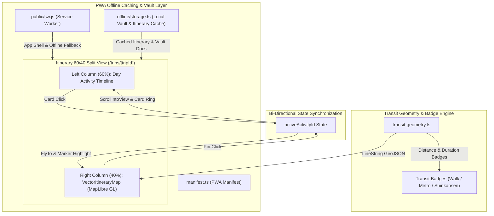

# Phase 6 Implementation Plan: Interactive Vector Map & PWA Offline Caching

> **For agentic workers:** REQUIRED SUB-SKILL: Use `superpowers:executing-plans` to implement this plan task-by-task. Steps use checkbox (`- [ ]`) syntax for tracking.

**Goal:** Integrate an interactive vector map (MapLibre GL with Geoapify vector tiles) into the WanderWay 60/40 Split View (`/trips/[tripId]`), synchronize numbered map pins with timeline cards bi-directionally, render real transit route polylines with distance and travel time badges (walking, metro, Shinkansen), and establish full PWA offline caching for itineraries and the Live Vault.

**Architecture:** Client-side vector map rendered via MapLibre GL with Geoapify vector tile styling and offline GeoJSON vector fallback. Route legs computed with Haversine distance and transit mode classification (walk vs. metro vs. high-speed rail/Shinkansen). Bi-directional synchronization via active activity state and DOM scroll targets. PWA offline architecture combining Service Worker (`public/sw.js`), Web App Manifest (`src/app/manifest.ts`), and LocalStorage/IndexedDB offline vault store (`src/lib/offline/storage.ts`).

**Tech Stack:** MapLibre GL, Next.js 16 (App Router), React 19, Tailwind CSS, Geoapify Vector Tiles & Routing APIs, Vitest, Service Worker API, Web App Manifest.

---

## Global Constraints
- PRD v3.0 Grounding Invariant: Real coordinates only; never fabricate coordinates or claim unverified pins.
- Offline Invariant: Never crash when offline or when Geoapify API key is absent; fallback gracefully to offline vector styling.
- Money Invariant: Currency amounts must maintain INR standard formatting with source evidence badges.
- Strict TypeScript & Vitest: Zero `any` where avoidable, all new logic validated with test-driven development (TDD).

---

## Review Focus
1. MapLibre GL SSR Safety: MapLibre GL must only instantiate on client (`typeof window !== "undefined"` in `useEffect`).
2. Vitest Node Environment: Tests run in Node (`environment: "node"`), so transit math, GeoJSON builders, and offline storage must be purely testable without DOM WebGL dependencies.
3. Smooth Bi-directional Focus: Clicking a map pin scrolls the card into view without jitter; clicking a card smoothly centers the map without infinite loops.
4. Shinkansen & Long Transit Support: Display appropriate units ("2h 15m", "452 km") for inter-city rail vs. "12 mins", "800m" for walking.
5. Service Worker Lifecycle: Service Worker caches must not stall development hot-reloads; uses versioned cache keys.

---

### Task 1: Transit Geometry & Vector GeoJSON Engine (TDD)

**Files:**
- Create: `src/lib/itinerary/transit-geometry.ts`
- Test: `tests/unit/itinerary/transit-geometry.test.ts`

**Interfaces:**
- Consumes: Waypoint coordinates `(lat, lng)`, distance in meters, duration in seconds.
- Produces:
  - `calculateHaversineDistance(lat1, lon1, lat2, lon2): number`
  - `formatTransitHoursMinutes(seconds: number | null | undefined): string`
  - `detectTransitMode(distanceMeters: number, explicitMode?: string | null): "walk" | "metro" | "shinkansen" | "drive"`
  - `generateTransitCurve(origin: [number, number], dest: [number, number], mode: string): [number, number][]`
  - `buildDayTransitGeoJSON(waypoints: WaypointItem[], transitLegs: TransitLegItem[]): GeoJSON.FeatureCollection`

- [ ] **Step 1: Write the failing test**
  Write tests in `tests/unit/itinerary/transit-geometry.test.ts` for Haversine distance, transit mode detection (walk < 1500m, shinkansen > 100km or named "shinkansen", metro for medium urban distance), transit duration formatting ("2h 15m", "35 mins"), and GeoJSON FeatureCollection generation.

- [ ] **Step 2: Run test to verify it fails**
  Run: `npm test tests/unit/itinerary/transit-geometry.test.ts`
  Expected: FAIL (module not found).

- [ ] **Step 3: Implement `src/lib/itinerary/transit-geometry.ts`**
  Implement the deterministic calculation functions and GeoJSON builders.

- [ ] **Step 4: Run test to verify it passes**
  Run: `npm test tests/unit/itinerary/transit-geometry.test.ts`
  Expected: PASS.

- [ ] **Step 5: Commit**
  `git add tests/unit/itinerary/transit-geometry.test.ts src/lib/itinerary/transit-geometry.ts && git commit -m "feat(transit): add deterministic transit geometry and GeoJSON engine with TDD"`

---

### Task 2: PWA Offline Storage & Manifest (TDD)

**Files:**
- Create: `src/lib/offline/storage.ts`
- Create: `src/lib/offline/use-offline.ts`
- Create: `src/app/manifest.ts`
- Create: `public/sw.js`
- Test: `tests/unit/offline/storage.test.ts`

**Interfaces:**
- Consumes: Browser CacheStorage and LocalStorage/IndexedDB interfaces.
- Produces:
  - `cacheItineraryOffline(tripId: string, data: unknown): void`
  - `getCachedItineraryOffline(tripId: string): unknown | null`
  - `cacheVaultOffline(tripId: string, documents: unknown): void`
  - `getCachedVaultOffline(tripId: string): unknown | null`
  - `useOfflineStatus(): { isOffline: boolean; isCached: boolean; lastSynced: Date | null }`

- [ ] **Step 1: Write the failing test**
  Write tests in `tests/unit/offline/storage.test.ts` validating serialization, storage, retrieval, offline trip caching, and vault document caching.

- [ ] **Step 2: Run test to verify it fails**
  Run: `npm test tests/unit/offline/storage.test.ts`
  Expected: FAIL.

- [ ] **Step 3: Implement `src/lib/offline/storage.ts`, `use-offline.ts`, `public/sw.js`, and `src/app/manifest.ts`**
  Implement the storage API with safety guards for SSR (`typeof window !== "undefined"`), write the service worker caching strategy, and configure Next.js manifest metadata.

- [ ] **Step 4: Run test to verify it passes**
  Run: `npm test tests/unit/offline/storage.test.ts`
  Expected: PASS.

- [ ] **Step 5: Commit**
  `git add tests/unit/offline/storage.test.ts src/lib/offline/ public/sw.js src/app/manifest.ts && git commit -m "feat(pwa): add PWA offline caching, manifest, and local vault persistence with TDD"`

---

### Task 3: MapLibre GL Vector Map Component

**Files:**
- Install: `maplibre-gl`
- Create: `src/components/maps/vector-itinerary-map.tsx`
- Test: `tests/unit/components/vector-itinerary-map.test.ts`

**Interfaces:**
- Consumes:
  - `waypoints: Array<{ id: string; step: number; title: string; lat: number; lng: number; time?: string; isAi?: boolean }>`
  - `transitLegs: Array<{ fromId: string; toId: string; mode: string; distanceMeters?: number; durationSeconds?: number }>`
  - `activeActivityId: string | null`
  - `onSelectWaypoint: (id: string) => void`
- Produces:
  - Interactive MapLibre GL canvas with Geoapify vector tiles
  - Numbered markers with pulse active ring
  - Transit polylines (dashed for walk, solid for metro, prominent amber for Shinkansen)
  - Distance & duration badges
  - Offline fallback canvas when offline or keyless

- [ ] **Step 1: Write the failing test**
  Write tests in `tests/unit/components/vector-itinerary-map.test.ts` testing waypoint coordinate sanitization, route leg badge formatting, and marker selection callback contracts.

- [ ] **Step 2: Run test to verify it fails**
  Run: `npm test tests/unit/components/vector-itinerary-map.test.ts`
  Expected: FAIL.

- [ ] **Step 3: Install `maplibre-gl` and implement `src/components/maps/vector-itinerary-map.tsx`**
  Install dependency and build component with client-only initialization, Geoapify vector tile integration, custom HTML markers, line layers, and fallback rendering.

- [ ] **Step 4: Run test to verify it passes**
  Run: `npm test tests/unit/components/vector-itinerary-map.test.ts`
  Expected: PASS.

- [ ] **Step 5: Commit**
  `git add package.json package-lock.json src/components/maps/vector-itinerary-map.tsx tests/unit/components/vector-itinerary-map.test.ts && git commit -m "feat(maps): add MapLibre GL vector itinerary map with Geoapify vector tiles and fallback"`

---

### Task 4: Integrate Vector Map & Bi-directional Sync into Itinerary 60/40 View

**Files:**
- Modify: `src/app/(dashboard)/trips/[tripId]/_components/itinerary-client-view.tsx`
- Test: `tests/unit/itinerary/sync-view.test.ts`

**Interfaces:**
- Wire `VectorItineraryMap` into right 40% column.
- Enrich `SHOWCASE_SCHEDULES` with real coordinates (Haneda Airport, Cerulean Shinjuku, Omoide Yokocho, Nishiki Market, Fushimi Inari, Gion Karyo, Tokyo Station, Kyoto Station, Nara Park, Todai-ji).
- Support DB activities with real `latitude` & `longitude`.
- Bi-directional synchronization:
  - Click card -> map highlights pin and flies to location.
  - Click pin -> timeline highlights card and scrolls card into view.

- [ ] **Step 1: Write test for bi-directional synchronization state logic**
  Write tests in `tests/unit/itinerary/sync-view.test.ts` validating waypoint extraction, coordinate normalization, and selection synchronization.

- [ ] **Step 2: Run test to verify it fails**
  Run: `npm test tests/unit/itinerary/sync-view.test.ts`
  Expected: FAIL.

- [ ] **Step 3: Update `itinerary-client-view.tsx`**
  Integrate `VectorItineraryMap`, attach card refs/DOM IDs, add active pin fly-to, wire badge cards and offline indicator.

- [ ] **Step 4: Run tests to verify they pass**
  Run: `npm test tests/unit/itinerary/sync-view.test.ts`
  Expected: PASS.

- [ ] **Step 5: Commit**
  `git add src/app/(dashboard)/trips/[tripId]/_components/itinerary-client-view.tsx tests/unit/itinerary/sync-view.test.ts && git commit -m "feat(itinerary): integrate interactive vector map and bidirectional pin synchronization in 60/40 split view"`

---

### Task 5: Integrate PWA Service Worker & Offline Vault Access

**Files:**
- Modify: `src/app/layout.tsx` (Service Worker registration script)
- Modify: `src/components/vault/stitch-vault-view.tsx` (Auto-cache documents offline and show offline indicator)
- Modify: `src/app/(dashboard)/trips/[tripId]/page.tsx` (Pass trip and days into offline cache)

- [ ] **Step 1: Add offline status banner and auto-caching to `StitchVaultView`**
  When vault documents load, persist them to local offline vault store. When offline, load from offline store and show "Offline Vault Mode" status banner.

- [ ] **Step 2: Register Service Worker in RootLayout (`src/app/layout.tsx`)**
  Register `/sw.js` safely in client-side lifecycle without blocking initial render.

- [ ] **Step 3: Run all unit tests**
  Run: `npm test`
  Expected: PASS (all tests pass).

- [ ] **Step 4: Run TypeScript typecheck**
  Run: `npm run typecheck`
  Expected: PASS (0 errors).

- [ ] **Step 5: Commit**
  `git add src/app/layout.tsx src/components/vault/stitch-vault-view.tsx && git commit -m "feat(pwa): register service worker and enable offline document vault caching"`

---

### Task 6: Full Verification, UI Click Flow Audit & Goal Completion

- [ ] **Step 1: Run complete test suite**
  `npm test`
- [ ] **Step 2: Run TypeScript check**
  `npm run typecheck`
- [ ] **Step 3: Run ESLint**
  `npm run lint`
- [ ] **Step 4: Verify git status and changes**
